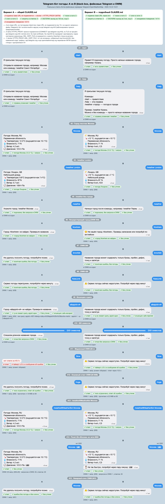

# Day1. CLAUDE.md: A против B

Дата: 2026-10-24. HTML-версия этого отчёта: [report.html](report.html).

## Цель

Понять, насколько содержимое `CLAUDE.md` влияет на качество кода, который генерирует агент. Задача у обоих вариантов одна:
Telegram-бот на Go, который по запросу присылает текущую погоду из OpenWeatherMap ([prompt.txt](prompt.txt)).

| Вариант | Файл правил | Объём | Содержание |
|---------|-------------|-------|------------|
| A | [variant-a/CLAUDE.md](variant-a/CLAUDE.md) | 16 строк | 14 общих пожеланий: «чистый код», «лучшие практики», «безопасно», «готово к продакшену» |
| B | [variant-b/CLAUDE.md](variant-b/CLAUDE.md) | 594 строки | стек, архитектура, структура папок, naming, конфигурация, контракты API, безопасность, UX-эталон, 5 примеров кода, 5 антипаттернов, шаблон файла, Definition of Done |

## Методология

- **Изоляция.** Каждый вариант запускался в чистом scratchpad (`git init`, внутри только `CLAUDE.md` варианта) командой
  `claude -p "$(cat prompt.txt)" --setting-sources project --model claude-opus-5-5 --permission-mode bypassPermissions --output-format json --max-budget-usd 6`.
  Флаг `--setting-sources project` отключает глобальный `~/.claude/CLAUDE.md` и пользовательские хуки.
- **Одинаковые условия.** Модель `claude-opus-5-5`, Claude Code 2.1.310, Go 1.26.5, macOS 27.0.1. Промпт байт в байт одинаковый, «на Go» указано в самом промпте. sha256 промпта и обоих `CLAUDE.md` записаны в [env.txt](env.txt).
- **`bypassPermissions`** выбрал пользователь, чтобы прогон шёл без интерактивных подтверждений. Бюджет ограничен $6 на прогон.
- **Метрики** собраны скриптом [compare/metrics.sh](compare/metrics.sh): build, vet, gofmt, golangci-lint, `go test -race` с покрытием, LOC, граф импортов, grep-чеклист.
- **Ручное review** по 16 критериям, каждый от 0 до 2 баллов: [compare/review.md](compare/review.md).
- **Black-box стенд** ([compare/harness](compare/harness/README.md)) запускает собранный бинарь без правок кода против фейковых Telegram и OWM: 15 сценариев, проверка утечек секретов, SIGTERM.

### Ограничения

- **n = 1.** По одному прогону на вариант, разброс между прогонами не измерялся. Выводы стоит читать как наблюдения, а не как статистику.
- **A проверен обходным путём.** Base URL у A зашит в коде (`DefaultBaseURL`), поэтому подменить его через env нельзя. A прогонялся в docker (linux, alpine) через MITM-прокси с одноразовым CA. B проверен штатно, через env.
- **Сценарий 7 (Error500) у B до OWM не дошёл.** Валидация отклонила ввод `Error500` из-за цифр. Ответ формально верный («понятная ошибка»), но путь 5xx через black-box у B не проверен. Это оговорка стенда. Путь 5xx покрыт юнит-тестами B (`openweather/client_test.go`).
- **Lint.** Системный golangci-lint 2.4.0 собран под go1.25 и падает на тулчейне 1.26. Метрики сняты golangci-lint 2.15.0, пересобранным под go1.26.5.
- **Flood (сценарий 14)** в итог «ожидаемое поведение» не входит, поэтому оценок 14, а не 15.

### Инциденты процесса

- В черновом прогоне harness фиктивный токен `TEST_FAKE_TOKEN` ушёл на настоящий `api.telegram.org` и получил 401: A игнорирует env с base URL. После этого в стенд добавлен прокси-предохранитель в режиме deny. Через него весь трафик, который ушёл мимо фейков, блокируется и записывается.
- Одноразовый CA стенда в системный keychain **не** добавлялся (проверено). Он передаётся только в контейнер через `SSL_CERT_FILE`.

## Скриншоты

Реальные ответы ботов из black-box прогона (слева A, справа B):



Отдельно: [chat-a.png](compare/screenshots/chat-a.png), [chat-b.png](compare/screenshots/chat-b.png), интерактивная версия [compare/chat-side-by-side.html](compare/chat-side-by-side.html).

## Метрики

Жирным выделено лучшее значение.

| Метрика | A | B |
|---------|---|---|
| `go build` / `go vet` | PASS / PASS | PASS / PASS |
| `gofmt -l` | 0 | 0 |
| golangci-lint default | 3 | 3 |
| golangci-lint extended | **4** | 5 |
| `go test -race` | PASS | PASS |
| Покрытие | 84.5% | **86.9%** |
| Тестов (`func Test`) | 24 | **33** |
| LOC prod / test | 726 / 567 | 812 / **852** |
| Файлов | 20 | 23 |
| `go.mod` | `go 1.25` | **`go 1.26`** (как в правилах) |
| Ходов агента | 20 | **13** |
| Время прогона | **214.7 с** | 525.5 с |
| Стоимость | **$0.888** | $1.421 |
| Ручное review | 22 / 32 | **30 / 32** |
| Black-box, ожидаемое поведение | 13 / 14 | **14 / 14** |
| Утечки токена и ключа (лог и ответы) | 0 | 0 |

Источники: [compare/metrics-a.txt](compare/metrics-a.txt), [compare/metrics-b.txt](compare/metrics-b.txt), [variant-a/run.json](variant-a/run.json), [variant-b/run.json](variant-b/run.json).

## Black-box сценарии

Данные: [compare/transcripts/a.json](compare/transcripts/a.json), [compare/transcripts/b.json](compare/transcripts/b.json). Время указано до первого ответа.

| # | Сценарий | A | B |
|---|----------|---|---|
| 1 | `/start` | ✓ 4 мс | ✓ 0 мс |
| 2 | `/help` | ✓ | ✓ |
| 3 | `Москва` | ✓ 1 запрос в OWM | ✓ 1 запрос в OWM |
| 4 | `/weather London` | ✓ | ✓ |
| 5 | `/weather` без города | ✓ подсказка, OWM не вызван | ✓ подсказка, OWM не вызван |
| 6 | `Nowhere` (OWM 404) | ✓ «не найден» | ✓ «не найден» |
| 7 | `Error500` (OWM 500) | ✓ общая ошибка | ✓* отклонён валидацией, до OWM не дошёл |
| 8 | `RateLimit` (OWM 429) | ✓ «перегружен» | ✓ «недоступен» |
| 9 | Инъекция `a&appid=x#` | ✓ экранирована, `appid` один | ✓ отклонена до OWM |
| 10 | 500 символов | ✓ отказ без OWM | ✓ отказ без OWM |
| 11 | `Slow` (OWM отвечает через 25 с) | **✗ ответа нет за 40 с** | ✓ ошибка через 10.0 с |
| 12 | `Huge` (50 MiB) | ✓ прочитано ~1.9 MiB | ✓ прочитано ~2.3 MiB |
| 13 | `/weather@WeatherBot Москва` | ✓ | ✓ |
| 14 | Flood 20 × «Москва» | 20 запросов в OWM, 20 ответов с погодой | 1 запрос в OWM, 1 погода + 19 × «Не так быстро» |
| 15 | Неверный ключ OWM (401) | ✓ без ключа в ответе | ✓ без ключа в ответе |
| | SIGTERM | graceful, 163 мс, код 0 | graceful, 3 мс, код 0 |
| | Способ запуска | docker + MITM (base URL зашит) | env `*_BASE_URL` |

## Ручное review (0–2 на критерий)

| Критерий | A | B |
|----------|---|---|
| Слои и направление зависимостей | 1 | 2 |
| Тестируемость | 2 | 2 |
| Покрытие и качество тестов | 1 | 2 |
| vet / gofmt / lint | 2 | 2 |
| Ошибки (`%w`, sentinel, статусы OWM) | 1 | 2 |
| Таймауты, context | 1 | 2 |
| Graceful shutdown | **2** | 1 |
| Конфиг и секреты | 2 | 2 |
| Redact токена и ключа | 2 | 2 |
| Построение URL, валидация города | 1 | 2 |
| LimitReader, статус до decode | 1 | 2 |
| Rate limit, flood, recover | 0 | 2 |
| Telegram: offset, `retry_after` | 1 | 2 |
| UX текстов | **2** | 1 |
| Naming | 2 | 2 |
| Соответствие своему CLAUDE.md | 1 | 2 |
| **Итого** | **22** | **30** |

### Найденные баги

| Вариант | Баг | Где |
|---------|-----|-----|
| A | Общий дедлайн на запрос к OWM и `sendMessage`: если OWM медленный, ответ не уходит вообще | `bot/bot.go:137`, `bot/handler.go:62` |
| A | JSON декодируется до проверки статуса: HTML-ответ 404/429/5xx теряет маппинг ошибки | `weather/client.go:106-111`, `telegram/client.go:118-121` |
| A | `/weather\nМосква` даёт «Неизвестная команда» | `bot/handler.go:52` |
| A | Ввод из одних пробелов даёт «Город «» не найден» | `bot/handler.go:31`, `weather/client.go:91` |
| A | Нет `recover`: паника в обработчике роняет процесс | `bot/bot.go:125-128` |
| B | Валидация города отвергает `Val-d'Or`, `Ust'-Kut`, цифры, деванагари, NFD-кириллицу | `usecase/weather.go:52-55` (правило из §7 CLAUDE.md B) |
| B | Сообщения обрабатываются последовательно: медленный OWM блокирует всех | `delivery/telegram/poller.go:73` |
| B | На каждое flood-сообщение уходит ответ «Не так быстро», 429 на `sendMessage` не ретраится | `delivery/telegram/handler.go:51-57` |
| B | SIGTERM обрывает текущий запрос и ответ | `poller.go:73`, `handler.go:55` |
| Оба | Дубли ответов после рестарта: offset подтверждается только следующим `getUpdates` | A `bot/bot.go:115`, B `poller.go:69` |

## Ключевые фрагменты диффа

Полный дифф: [compare/diff.patch](compare/diff.patch) (3209 строк). Пути указаны относительно `variant-a/src` и `variant-b/src`.

### 1. OWM-клиент: статус до decode

A, `internal/weather/client.go:104-114`. Тело декодируется раньше, чем проверяется статус:

```go
defer resp.Body.Close()

var body apiResponse
if err := json.NewDecoder(io.LimitReader(resp.Body, maxResponseBytes)).Decode(&body); err != nil {
    return Weather{}, fmt.Errorf("decode weather response (status %d): %w", resp.StatusCode, err)
}

if err := statusError(resp.StatusCode, body.Message); err != nil {
    return Weather{}, err
}
```

B, `internal/repository/openweather/client.go:71-80` (почти дословно пример 9.3 из CLAUDE.md B):

```go
defer resp.Body.Close()

if err := statusError(resp.StatusCode); err != nil {
    return domain.Weather{}, err
}
var body currentResponse
if err := json.NewDecoder(io.LimitReader(resp.Body, maxBodyBytes)).Decode(&body); err != nil {
    return domain.Weather{}, fmt.Errorf("%w: decode response: %v", domain.ErrProviderUnavailable, err)
}
```

### 2. Построение URL Telegram

A, `internal/telegram/client.go:105`. Токен вставляется через `Sprintf` без проверки формата:

```go
endpoint := fmt.Sprintf("%s/bot%s/%s", c.baseURL, c.token, method)
```

B, `internal/delivery/telegram/client.go:104-109`. Используется `JoinPath`, формат токена проверен в `config` (`config.go:106-125`):

```go
u, err := url.Parse(c.baseURL)
if err != nil {
    return fmt.Errorf("parse base url: %w", err)
}
u = u.JoinPath("bot"+c.token, apiMethod) // формат токена проверен в config
u.RawQuery = q.Encode()
```

### 3. main и DI: откуда берётся base URL

A, `cmd/weatherbot/main.go:37-38`. В конструктор передаётся пустой base URL, значит берётся зашитый `DefaultBaseURL`. Env для него нет:

```go
tg := telegram.NewClient(&http.Client{Timeout: pollTimeout + 10*time.Second}, "", cfg.TelegramToken)
owm := weather.NewClient(&http.Client{Timeout: cfg.RequestTimeout}, "", cfg.WeatherAPIKey, cfg.WeatherUnits, cfg.WeatherLang)
```

B, `cmd/weatherbot/main.go:38-42` (пример 9.5 дословно). Base URL приходит из env `TELEGRAM_BASE_URL` и `OPENWEATHER_BASE_URL` (`config/config.go:35-36`):

```go
weather := openweather.NewClient(cfg.OpenWeatherBaseURL, cfg.OpenWeatherAPIKey, &http.Client{Timeout: 10 * time.Second})
service := usecase.NewWeatherService(weather)
bot := telegram.NewClient(cfg.TelegramBaseURL, cfg.TelegramBotToken, &http.Client{Timeout: 40 * time.Second})
handler := telegram.NewHandler(service, bot, logger)
poller := telegram.NewPoller(bot, handler, logger)
```

### 4. Валидация города

A, `internal/bot/handler.go:57-59`. Проверяется только длина, безопасность обеспечивает `url.Values`:

```go
if utf8.RuneCountInString(city) > maxCityLength {
    return cityTooLongText
}
```

B, `internal/usecase/weather.go:44-58`. Правило §7 CLAUDE.md B перенесено целиком, вместе с его дефектом: апострофы и цифры запрещены.

```go
city := strings.Join(strings.Fields(raw), " ")
if n := utf8.RuneCountInString(city); n == 0 || n > maxCityRunes {
    return "", domain.ErrInvalidCity
}
for _, r := range city {
    if !unicode.IsLetter(r) && !strings.ContainsRune(" -.,", r) {
        return "", domain.ErrInvalidCity // заодно отсекает управляющие символы
    }
}
```

### 5. Конкурентность: здесь A лучше

A, `internal/bot/bot.go:120-128`. Семафор на 16 обработчиков, `context.WithoutCancel` и `wg.Wait` при остановке:

```go
select {
case b.sem <- struct{}{}:
case <-ctx.Done():
    return nil
}
wg.Go(func() {
    defer func() { <-b.sem }()
    b.handleMessage(handlerCtx, msg)
})
```

B, `internal/delivery/telegram/poller.go:68-74`. Обработка синхронная, прямо в цикле polling:

```go
for _, u := range updates {
    offset = max(offset, u.UpdateID+1)
    if u.Message == nil || u.Message.Text == "" {
        continue
    }
    p.handler.Handle(ctx, u.Message.Chat.ID, u.Message.Text)
}
```

## Что сильнее всего повлияло на качество

Факторы отсортированы по силе влияния.

1. **Примеры рабочего кода (§9 и §11 CLAUDE.md B).** Это самый сильный рычаг. Около 345 строк, то есть примерно 42% из 812 строк prod-кода B, взяты из примеров почти дословно: `main.go` и `domain` один в один, в OWM-клиенте изменены 2 строки из 117, в usecase 5 из 55. Рычаг работает в обе стороны. Вместе с хорошими решениями переносятся и ошибки правила: строгая валидация города отвергает `Val-d'Or` и названия с цифрами, а sentinel-ошибки остались без doc-комментариев (замечание revive). Явные дефекты шаблона B всё же исправил сам: `\n` в `parseCommand`, неограниченную карту rate limit, `%w` с URL-ошибкой.
2. **Явные контракты и порты (§6).** `baseURL` и `*http.Client` передаются в конструктор, base URL настраивается через env. Это вопрос тестируемости. B проверяется black-box штатно, через env. Для A понадобились docker, MITM-прокси и одноразовый CA, а черновой прогон отправил фиктивный токен на настоящий `api.telegram.org`.
3. **Антипаттерны и security-запреты (§7, §10).** Статус до decode, `io.LimitReader`, per-chat rate limit, `recover`, `retry_after`, `url.Values` и `JoinPath`. Именно за эти пункты B получил +1…+2 по шести критериям review (1, 5, 10, 11, 12, 13). В A из этого есть только то, до чего модель додумалась сама: `LimitReader` есть, но статус проверяется после decode. `recover`, rate limit и `retry_after` отсутствуют, в результате 20 запросов в OWM на flood против одного у B.
4. **Структура папок и слои (§2, §3).** Раскладка B совпадает с правилами 1:1 (`domain`, `usecase`, `repository`, `delivery`). `domain` импортирует только `errors`, что проверено скриптом. У A своя раскладка «пакет на интеграцию» и утилитный пакет `httpx`, домена и usecase нет.
5. **UX-эталон и тексты в `messages.go` (§8).** Формат ответа совпадает с эталоном до символа (`format_test.go`), тексты дружелюбные и единообразные. Обратная сторона: B жёстко зашил `metric`/`ru`, а A сделал настраиваемые единицы и язык.
6. **Конкретика версий (§1).** B написал `go 1.26`, как требуют правила. A без указаний выбрал `go 1.25`.

### Чего правила B не дали

- **Конкурентность.** В CLAUDE.md B нет правила о параллельной обработке апдейтов. В результате B обрабатывает сообщения последовательно и по этому пункту хуже A: медленный OWM задерживает всех пользователей, а SIGTERM обрывает начатые ответы.
- **Цена.** CLAUDE.md B длиной 594 строки обошёлся на 60% дороже ($1.421 против $0.888) и занял в 2.4 раза больше времени (525.5 с против 214.7 с), хотя ходов было меньше (13 против 20). Контекст на каждом ходу больше: 605 тыс. cache-read токенов против 286 тыс.
- **n = 1.** Все различия получены на одном прогоне каждого варианта.

## Выводы

- Подробный CLAUDE.md заметно поднял качество: review 30/32 против 22/32, black-box 14/14 против 13/14. Главный выигрыш дают **защитные механизмы и тестируемость**, о которых общие формулировки вроде «делай безопасно» и «готово к продакшену» ничего конкретного не говорят.
- Общие правила A дали грамотный идиоматичный код с лучшей конкурентностью, graceful shutdown и гибким конфигом. Всё, о чём правила не сказали явно (rate limit, recover, статус до decode, подменяемый base URL), модель пропустила.
- Примеры кода работают как копипаст. Каждая строка в примере — это фактически требование, поэтому ошибки в примерах обходятся дороже ошибок в тексте.

## Рекомендации к CLAUDE.md

Что добавить или исправить в варианте B:

1. **Правило конкурентности.** Апдейты обрабатываются параллельно с ограничением (семафор N), каждый обработчик под `recover`. При остановке используется `context.WithoutCancel` + `WaitGroup`, чтобы начатые ответы дошли. Нужен пример кода.
2. **Раздельные дедлайны.** У запроса к OWM свой таймаут, у `sendMessage` свой, уже после ответа OWM. Пользователь получает текст ошибки даже при медленном провайдере.
3. **Тестируемая и мягкая валидация города.** Разрешить апострофы (`'`, `’`), цифры и комбинирующие знаки (`unicode.Mn`), нормализовать в NFC. В правило вписать таблицу примеров, которые должны проходить (`Val-d'Or`, `Ust'-Kut`, `मुंबई`, `Санкт-Петербург`, `New York`) и которые не должны (управляющие символы, >64 рун, пустая строка), и потребовать по ней табличный тест.
4. **Offset при рестарте.** Перед выходом подтвердить последний обработанный `update_id` (`getUpdates` с `offset` и `timeout=0`), чтобы после рестарта не было дублей.
5. **Flood на исходящих.** На превышение лимита отвечать один раз за окно, остальные сообщения молча отбрасывать. Учитывать 429 и `retry_after` на `sendMessage`.
6. **Doc-комментарии на экспортируемых sentinel-ошибках** прямо в примере 9.1, чтобы revive не ругался на скопированный код.
7. **Настраиваемые `units`/`lang`** через env с дефолтами `metric`/`ru`.
8. **Сократить объём.** Длинные примеры стоит оставить только там, где без них модель ошибается (HTTP-адаптер, main/DI, обработчик). Остальное можно описать короткими правилами. Это снизит стоимость и время прогона.

Для варианта A минимальный набор, который закрыл бы большинство его багов: «base URL и `*http.Client` в конструктор, base URL из env», «статус до decode», «per-chat rate limit», «`recover` в каждом обработчике», «отдельный дедлайн на отправку ответа».

## Артефакты

| Что | Путь |
|-----|------|
| Промпт и окружение | [prompt.txt](prompt.txt), [env.txt](env.txt) |
| Правила | [variant-a/CLAUDE.md](variant-a/CLAUDE.md), [variant-b/CLAUDE.md](variant-b/CLAUDE.md) |
| Сгенерированный код | [variant-a/src](variant-a/src), [variant-b/src](variant-b/src) |
| Итоги прогонов `claude -p` | [variant-a/run.json](variant-a/run.json), [variant-b/run.json](variant-b/run.json) |
| Метрики | [compare/metrics-a.txt](compare/metrics-a.txt), [compare/metrics-b.txt](compare/metrics-b.txt), [compare/metrics.sh](compare/metrics.sh) |
| Дерево файлов | [compare/tree-a.txt](compare/tree-a.txt), [compare/tree-b.txt](compare/tree-b.txt) |
| Дифф | [compare/diff.patch](compare/diff.patch) |
| Ручное review | [compare/review.md](compare/review.md) |
| Black-box стенд и транскрипты | [compare/harness](compare/harness/README.md), [compare/transcripts](compare/transcripts) |
| Скриншоты чатов | [compare/screenshots](compare/screenshots), [compare/chat-side-by-side.html](compare/chat-side-by-side.html) |
| HTML-отчёт | [report.html](report.html) |
