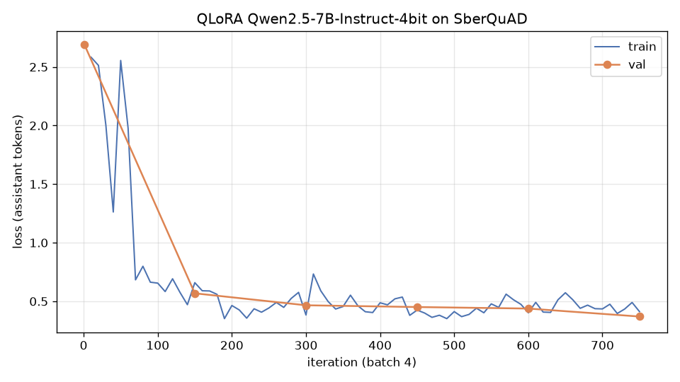
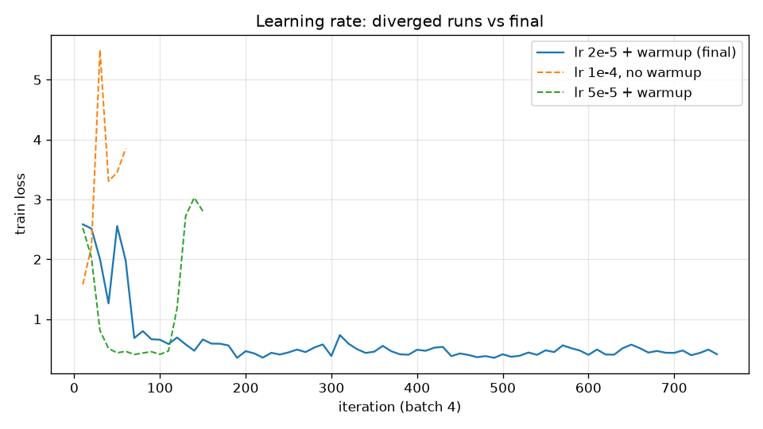

# Day 6. QLoRA-дообучение Qwen2.5-7B на MLX: роль «эрудит», датасет SberQuAD

**Дата:** 2026-10-31
**Итог одной строкой:** модель обучена на MacBook за 95.5 мин (QLoRA, 750 шагов), val loss снизился с 2.69 до 0.37, адаптер сохранён. На 116 отложенных вопросах точных совпадений стало больше: EM 0.31 → 0.39, F1 0.64 → 0.66. Модель научилась отвечать короткой цитатой, но часто обрезает ответ, а грубых промахов стало вдвое больше (9 → 19). По F1 улучшений и ухудшений поровну: 40 против 42.

## 1. На чём и сколько обучали

| Параметр | Значение |
|---|---|
| Железо | MacBook, Apple M4 Max, 36 GB unified memory, от сети |
| ОС / ПО | macOS (Darwin 27.0.0), Python 3.12, mlx 0.32.4, mlx-lm 0.32.2 |
| Базовая модель | `mlx-community/Qwen2.5-7B-Instruct-4bit` (4-bit, group 64). fp16-тензоры (scales, biases, нормы, эмбеддинги) переведены в bf16 скриптом `to_bf16.py`, квантованные веса не трогали |
| Метод | QLoRA: LoRA-адаптеры поверх замороженной 4-битной модели (`mlx_lm.lora`) |
| LoRA | rank 8, scale 20, dropout 0.05, q/k/v/o_proj, последние 16 из 28 слоёв |
| Обучаемых параметров | 2.884M из 7615.6M (0.038%) |
| Оптимизация | Adam; lr: прогрев 0 → 2e-5 за 50 шагов, затем cosine до 2e-6; batch 4; 750 итераций = 1 эпоха; seed 42 |
| Loss | только по токенам ответа (`mask_prompt: true`) |
| Данные | 3000 train / 200 valid, ~1.09M токенов за эпоху (медиана 344 токена на пример, максимум 722) |
| **Время обучения** | **5731 с = 95.5 мин** (02:54:47 → 04:30:19), включая 6 валидаций по ~95 с |
| Скорость | ~7.6 с/итерацию, ~190 tok/s с учётом промпта. В колонке `tok/s` mlx-lm показывает только токены ответа (~8 tok/s) |
| Пик памяти | 21.0 GB |
| Адаптер | `adapters/adapters.safetensors` (11.5 MB) + `adapter_config.json`, чекпоинты на шагах 250, 500, 750 |
| Сравнение до/после | 238 с (120 вопросов × 2 модели) |

Полная конфигурация: `lora_config.yaml`. Воспроизведение:

```bash
uv venv -p 3.12 .venv && uv pip install -p .venv/bin/python mlx-lm datasets matplotlib
.venv/bin/python to_bf16.py models/qwen2.5-7b-instruct-4bit-bf16
.venv/bin/python prepare_data.py
.venv/bin/mlx_lm.lora -c lora_config.yaml
.venv/bin/python plot_loss.py results/train.log
.venv/bin/python compare.py --extra 100
```

## 2. Данные и шаблон

**Источник:** `kuznetsoffandrey/sberquad` (Hugging Face, parquet). Это фрагменты статей русской Википедии, вопрос к каждому и ответ, который является точной цитатой из фрагмента. Train 45 328, validation 5 036. В test-сплите ответы пустые, его не использовали.

**Подготовка** (`prepare_data.py`):
- выброшены фрагменты длиннее 1500 символов (p90 ≈ 1100), чтобы длина последовательности подходила для ноутбука;
- valid отделён от train **по фрагментам**: 300 фрагментов целиком ушли в valid, поэтому вопрос к уже виденному тексту в валидацию не попадает;
- из train взято 3000 вопросов, из valid 200;
- отложенный пул для сравнения: 300 вопросов из validation-сплита SberQuAD, при обучении не использовались.

**Шаблон Qwen2.5** — ChatML. `mlx_lm` применяет его сам через `tokenizer.apply_chat_template` к формату `{"messages": [...]}`:

```
<|im_start|>system
Ты — эрудит. Тебе дают фрагмент статьи и вопрос. Отвечай кратко, точной цитатой из фрагмента, без пояснений.<|im_end|>
<|im_start|>user
Фрагмент статьи:
<текст фрагмента>

Вопрос: <вопрос><|im_end|>
<|im_start|>assistant
<ответ — цитата из фрагмента><|im_end|>
```

## 3. Loss по ходу обучения



| Итерация | 1 | 150 | 300 | 450 | 600 | 750 |
|---|---|---|---|---|---|---|
| val loss | 2.691 | 0.568 | 0.466 | 0.451 | 0.438 | 0.370 |

За первые ~70 шагов train loss падает с 2.6 до ~0.7: модель усваивает формат «короткая цитата без пояснений». Дальше он медленно снижается и колеблется в диапазоне 0.35–0.75. Val идёт вровень с train или ниже, переобучения нет. Плато не наступило, последний отрезок дал заметное снижение (0.438 → 0.370), так что вторая эпоха, вероятно, ещё помогла бы по loss. Сырые точки: `results/loss.csv`, лог: `results/train.log`.

### Откаты по ходу обучения



| Запуск | lr | Что случилось | Лог |
|---|---|---|---|
| 1 | 1e-4, без прогрева | loss 1.58 на шаге 10, затем 5.5 на шаге 30, дальше 3.3–3.9. Расхождение, остановлен на шаге 60 | `results/train_lr1e-4_diverged.log` |
| 2 | 5e-5, прогрев 50 + cosine | дошёл до 0.41, на шаге 120 скачок до 1.19 → 3.0, val на шаге 150 3.04 (хуже исходного). Остановлен | `results/train_lr5e-5_diverged.log` |
| 3 | 2e-5, прогрев 50 + cosine | стабильно, это финальный запуск | `results/train.log` |

Причина расхождения. При `scale: 20` фактический шаг LoRA-обновления в 20 раз больше номинального. Ответы в SberQuAD короткие: в среднем ~14 токенов на пример, ~55 токенов loss на батч. Градиент получается шумным, и Adam без клиппинга (в `mlx_lm.lora` его нет) срывается. Дефолт mlx-lm — lr 1e-5. Порядок батчей во всех запусках одинаковый (seed 42), поэтому кривые можно сравнивать шаг в шаг: на тех же батчах 111–150, где запуск 2 разошёлся, запуск 3 держал 0.47–0.69. На два неудачных запуска ушло ~30 мин (9 + 21).

Ещё раньше, на другом датасете, был запуск с fp16-scales: на шаге 40 loss стал NaN (`results/train_fp16_nan.log`). Поэтому базовая модель переведена в bf16 (`to_bf16.py`).

## 4. Сравнение до/после

`compare.py`: одни и те же промпты подаются базовой модели и модели с адаптером. Базовая модель — та же bf16-копия, на которой обучали. Декодирование жадное (temp 0), не больше 300 токенов. Набор:
- **20 фиксированных запросов:** 16 вопросов SberQuAD из отложенного пула (с фрагментом) и 4 общих вопроса без контекста (system: «Ты — эрудит.»). Общие вопросы проверяют регрессию вне задачи;
- **ещё 100 вопросов** из того же пула, только для метрик.

Метрики (нормализация как в SQuAD: регистр, ё→е, без пунктуации):
- **EM** — ответ совпал с эталоном;
- **F1** — пересечение слов с эталоном;
- **contains** — эталон целиком, по словам, содержится в ответе.

| Набор | Модель | EM | F1 | contains | Длина ответа, симв. | Время, с |
|---|---|---|---|---|---|---|
| 16 фикс. | base | 0.312 | **0.775** | **0.688** | 47 | 0.88 |
| | tuned | 0.312 | 0.630 | 0.312 | 17 | 0.73 |
| 100 доп. | base | 0.310 | 0.617 | **0.760** | 64 | 1.02 |
| | tuned | **0.400** | **0.668** | 0.450 | 22 | 0.86 |
| **Все 116** | base | 0.310 | 0.639 | **0.750** | 62 | 1.00 |
| | tuned | **0.388** | **0.663** | 0.431 | 21 | 0.84 |

Попарно по F1 на 116 вопросах: tuned лучше в 40, хуже в 42, одинаково в 34. На 16 фиксированных вопросах tuned хуже по F1, на 100 дополнительных лучше. Разница в пределах разброса, существенного прироста качества нет.

Типы ответов на 116 вопросах:

| Тип ответа | base | tuned |
|---|---|---|
| Точно как эталон | 36 | **45** |
| Длиннее эталона, но содержит его целиком (ответ фразой) | **51** | 5 |
| Короче эталона, часть цитаты (обрезан) | 13 | **33** |
| Частичное пересечение | 7 | 14 |
| Мимо (ни одного общего слова) | **9** | **19** |

Средняя длина: эталон 3.7 слова, base 8.3, tuned 3.0. Tuned отвечает даже короче эталона.

### Все 20 запросов

| # | Вопрос (сокр.) | Эталон | Base | Tuned | Вердикт |
|---|---|---|---|---|---|
| 1 | Какой журнал выпускает совет? | Журнал Корпоративное управление | Корпоративное управление. | Корпоративное управление | одинаково (F1 0.8) |
| 2 | Почему мосты со стрельчатыми арками потеряли популярность? | неоправданно увеличивал высоту моста | точно | точно | одинаково |
| 3 | Как варьируются масти у овец? | от молочно-белого до тёмно-бурого и чёрного | цитата внутри фразы «Масть различна… — от…» | точно | **лучше** |
| 4 | Среди кого бытует мнение, что Птолемей не составлял карт? | Среди историков картографии | цитата + «существует такая точка зрения» | точно | **лучше** |
| 5 | Какой период криптографии — с открытым ключом? | с конца 1970-х годов по настоящее время | точно | «с конца 1970-х годов» | **хуже** (обрезан) |
| 6 | Один из случаев перестройки хромосом? | удвоение части (дупликация)… | «потеря (делеция) или удвоение…» (оба случая) | «делеция» | **хуже** (другой случай, F1 0) |
| 7 | Когда заложены основы швейцарского государства? | в 1291 году | фраза с «в 1291 году» | «1291» | по смыслу одинаково, метрика хуже |
| 8 | Когда открыты циклы Китчина? | в 1920-е годы | «1920-е годы» | точно | **лучше** |
| 9 | Что создаёт опорную реакцию для рамы? | поток касательных усилий | цитата + хвост | точно | **лучше** |
| 10 | Когда принят герб Екатеринодара? | В 1849 году | «1849 году» | «1849» | по смыслу одинаково |
| 11 | Что ослабевает в румынском под влиянием славянских? | Общая артикуляция речи | цитата + длинное продолжение | «в общую артикуляцию речи» (изменена форма слова) | **хуже** по метрике, смысл верен |
| 12 | С кем Дерлет не мог сравниться? | со своим учителем | «своим учителем» | «Лавкрафт.» | **хуже**: имя не из цитаты, ответ по знаниям модели |
| 13 | Частью какой империи стали Афины? | частью Османской империи | «Османской империи.» | «Османской» | **хуже** (обрезан) |
| 14 | Сколько суток подлодка под водой? | до 20 суток | точно | «до 20» | **хуже** (потеряна единица) |
| 15 | Для чего формы dvoje, troje? | для обозначения одинаковых предметов | точно | «одинаковых» | **хуже** (обрезан до 1 слова) |
| 16 | Что искал Руссо в науках и художествах? | душевного отдыха и источника славы | точно | «душевного отдыха» | **хуже** (потеряна половина) |
| 17 | 17 × 23, ответь числом | — | 391 | 391 | одинаково |
| 18 | Кратко о Гагарине | — | ~500 симв., ошибка «родился в селе Калуга», «умер при загадочных обстоятельствах» | ~780 симв., не «кратко»; выдуманы «Камышино, Саратовская обл.», «Высшая космическая школа в Костроме» | **хуже**: длиннее и больше выдумки |
| 19 | Python-палиндром | — | код + примеры | код + docstring + примеры | одинаково |
| 20 | Почему небо голубое (2 предложения) | — | рассеяние **Рэлея** — верно | рассеяние **Рамана** — фактическая ошибка | **хуже** |

## 5. Что изменилось, а что осталось прежним

**Изменилось:**
- **Формат.** Tuned отвечает голой цитатой без вводных фраз, точки и пересказа вопроса. Ответов «длиннее эталона» стало 5 вместо 51, точных совпадений 45 вместо 36. Ответы в 3 раза короче (21 символ против 62) и на ~15% быстрее.
- **Исправлены сбои base.** Отказы («Фрагмент статьи не содержит точной даты…» при ответе «в середине XV века» в тексте), переход на английский («мunicipal commission»), ответ не по фрагменту («XXXV—XI века до н. э.» вместо «более 2000 лет»). На этих 4 вопросах tuned ответил точно.
- **Чрезмерная краткость.** Модель усвоила «чем короче, тем лучше» сильнее, чем было в эталонах: 33 ответа обрезаны против 13 у base. Часто теряются предлог или единица («1291», «до 20», «Османской»), иногда половина ответа («душевного отдыха»).

**Осталось прежним:**
- Понимание текста и умение найти нужное место. По F1 качество на уровне base (0.66 против 0.64, попарно 40/42).
- Общие навыки: арифметика, генерация кода и следование инструкции «ответь числом» не сломались.
- Склонность выдумывать факты без контекста (Гагарин) есть у обеих моделей.

## 6. Где дообученная модель стала хуже

1. **Обрезанные ответы** — главная регрессия, 33 из 116. Метрика `contains` упала с 0.75 до 0.43: в base правильная цитата почти всегда присутствовала, хоть и внутри фразы. Примеры: #5, #13, #14, #15, #16.
2. **Промахов стало больше: 19 против 9.** Модель отвечает не цитатой, а коротким словом по своим знаниям или догадке:
   - «Лавкрафт» вместо «со своим учителем»;
   - «Нет» на «Всегда ли атеросклероз — следствие холестерина?» (эталон — цитата-обоснование);
   - «возврат средств» вместо «списание с карты ошибочно зачисленной суммы»;
   - «ТВК» вместо «на принципах TQM»;
   - «Бразильцы» вместо имён;
   - «делеция» вместо второго случая из перечисления.

   Base в этих случаях давал правильную цитату. В одном ответе tuned сорвался в бессвязный текст на белорусском («вельшскі налет і мятыж лузітаноў…») на вопросе про раскопки Помпей.
3. **Вне задачи.** В ответе «почему небо голубое» появилась фактическая ошибка (рассеяние Рамана вместо Рэлея). На «кратко расскажи о Гагарине» ответ в 1.6 раза длиннее (783 против 496 символов), с бо́льшим числом выдуманных деталей. Это общий вопрос без контекста. Дообучение на коротких цитатах должно было сделать ответы короче, вышло наоборот: поведение вне задачи сдвинулось непредсказуемо.
4. **Заметка о метрике.** Часть «ухудшений» (#7, #10, #11) — это нестрогость разметки SberQuAD. Эталоны то с предлогом («в 1291 году»), то без него («муниципальной»), иногда с мусором («Журнал Корпоративное управление .»). Без этого шума EM у обеих моделей был бы выше, но вывод не изменился бы.

## 7. Выводы и что делать дальше

Пайплайн на MacBook работает от начала до конца: SberQuAD → ChatML → QLoRA на MLX → адаптер → сравнение. На подбор устойчивого lr ушло два запуска. Модель устойчиво выучила **формат** (короткая цитата, никаких отказов и английского). **Точность понимания** не изменилась: Qwen2.5-7B-Instruct уже хорошо решает extractive QA по инструкции, F1 0.64 без обучения. Одна эпоха на 3000 примерах сместила стиль, но не добавила навыка. Главная новая проблема — привычка резать ответ и отвечать «по памяти» вместо цитаты.

Что попробовать, по убыванию ожидаемого эффекта:
1. **Чистить разметку** (единообразно с предлогами или без, убрать мусорные хвосты) и/или брать только ответы, которые дословно встречаются в контексте по `answer_start`. Сейчас модель учится на противоречивых эталонах.
2. **Вторая эпоха / 6–10 тыс. примеров.** Val loss ещё снижался (0.438 → 0.370 на последнем отрезке). Это ~3 ч на этом ноутбуке.
3. **Replay общих инструкций (10–20%)** против регрессии вне задачи (Рэлей/Раман, Гагарин).
4. **lr:** не выше 2e-5 при scale 20. Либо уменьшить scale до ~8 и оставить lr 5e-5. `grad_accumulation_steps: 4`, чтобы сгладить шум коротких ответов.
5. В продакшене модель использовать с ограниченным декодированием или пост-проверкой: «ответ должен быть подстрокой фрагмента». Это убирает класс промахов «Лавкрафт / ТВК / Бразильцы».

## 8. Артефакты

| Файл | Что это |
|---|---|
| `prepare_data.py` | SberQuAD → `data/train.jsonl`, `data/valid.jsonl`, `data/test_pool.jsonl` |
| `to_bf16.py` | Копия 4-bit модели с bf16 вместо fp16 (фикс NaN) |
| `lora_config.yaml` | Параметры QLoRA (финальный запуск) |
| `adapters/` | Обученный адаптер + чекпоинты |
| `plot_loss.py` | `results/loss.png`, `results/loss.csv`, `results/loss_lr.png` |
| `compare.py` | `results/compare_20.json` (20 запросов, полные ответы), `results/compare_extra.json` (100), `results/summary.json` |
| `results/train.log` | Лог финального обучения |
| `results/train_lr1e-4_diverged.log`, `results/train_lr5e-5_diverged.log`, `results/train_fp16_nan.log` | Логи неудачных запусков |

Статус: **Done.** Модель обучена, адаптер сохранён, параметры запуска и сравнение на 20 (+100) запросах зафиксированы. Качество близко к базовой модели: формат лучше, полнота ответов хуже. Регрессии перечислены выше.
