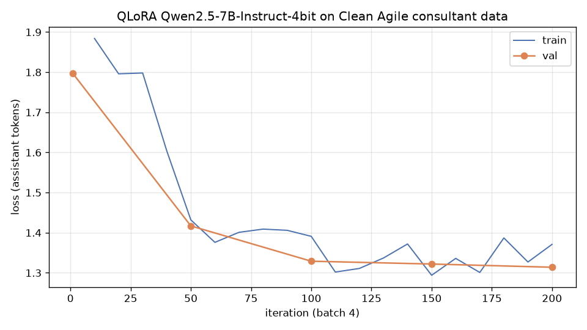
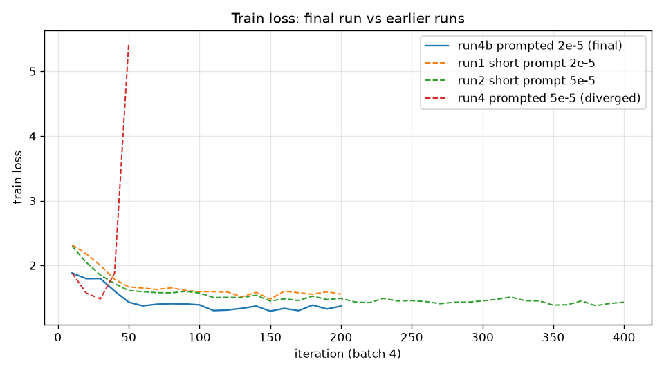

# Day 7. Свой датасет: Agile-консультант по книге «Чистый Agile»

**Дата:** 2026-10-31
**Итог одной строкой:** собран датасет из 279 примеров по книге Роберта Мартина (train 249 / valid 30) и eval-набор из 57 примеров, который прошёл два независимых аудита на утечки. Модель дообучена с нуля на чистой базе Qwen2.5-7B-Instruct-4bit (QLoRA). На eval обе модели угадывают вердикт и принцип одновременно в 0.439 случаев: дообученная и базовая с проработанным промптом. Тюнинг поднял точность вердикта с 0.63 до 0.70 и исправил главный перекос базы: верный вердикт «Соответствует» она ставила в 21% случаев, после тюнинга в 71%. Цена — меньше верных «Риск» и немного хуже выбор принципа. Без инструкций база даёт 0. На eval с утечками тюнинг выглядел бы как +12 п.п.: это эффект запоминания, а не обобщения.

## 1. Задача

Консультант получает описание ситуации в команде (сообщение в чат, план спринта, тикет, протокол встречи) и проверяет, соблюдается ли процесс. Верный ответ — тот, что соответствует принципам Agile в изложении книги.

Ответ строго в 4 строки. Это делает результат проверяемым:

```
Вердикт: <Соответствует | Нарушение | Риск>
Принцип: <одно из 15 названий>
Обоснование: <1–2 предложения>
Рекомендация: <1–2 предложения, повелительное наклонение>
```

- **Нарушение** — действие прямо противоречит практике.
- **Риск** — практика ещё не нарушена, но решение или тенденция к этому ведёт.
- **Соответствует** — действие соответствует практике.

15 принципов (`principles.json`) взяты из оглавления книги, у каждого указан диапазон страниц. Это планирование, управление по данным (железный крест), небольшие частые релизы, приёмочное тестирование, одна команда, устойчивый темп, коллективное владение, непрерывная интеграция, стендап, TDD, рефакторинг, простота проектирования, парное программирование, билль о правах, ценности и внедрение Agile.

**Метрики** (`eval.py`, считаются автоматически, без LLM-судьи):
- `format_ok` — все 4 строки на месте, метки из закрытого списка;
- `verdict_acc`, `principle_acc` — точность по вердикту и по принципу;
- `both_acc` — верны обе метки одновременно; это **главная метрика**;
- `*_lenient` — метка ищется по всему тексту, а не в своей строке. Это нужно, чтобы модель, отвечающая свободным текстом, не получала 0 только за формат.

## 2. Данные

### Источник и генерация

Книгу `чистый_agile.pdf` перевели в текст (`pdftotext`) и разбили по страницам (`book/pages.jsonl`). Номер страницы PDF совпадает с печатным.

Готовых логов и тикетов по этой задаче нет, поэтому входы сгенерированы моделью. Это разрешено заданием («чего не хватает — сгенерируйте входы моделью»). Работали 5 субагентов Claude, по 3 принципа на каждого (`gen/GEN_TRAIN.md`). Каждый сначала прочитал страницы своих разделов книги, затем написал по 20 примеров на принцип: 9 «Нарушение», 5 «Риск», 6 «Соответствует». В каждом примере указаны страницы, на которые он опирается. Eval писал отдельный агент (`gen/GEN_EVAL.md`), по 4 примера на принцип.

Требования к ситуациям:
- разные роли: разработчик, тимлид, PM, CTO, QA, заказчик;
- разные форматы: чат, тикет, ретро, протокол;
- разные домены: банк, ритейл, медицина, госуслуги, игры и другие;
- вердикт и название принципа в тексте не называются.

### Чистка (`clean.py`)

| Шаг | Было | Стало | Что сделано |
|---|---|---|---|
| Сгенерировано | 300 | | 5 групп × 60 |
| Смысловые дубли внутри train | 300 | 279 | 21 пара с одинаковым решающим действием (`data/semantic_leaks.json`), найдены агентом-аудитором |
| Точные дубли и почти-дубли (Jaccard символьных 3-грамм ≥ 0.5) | 279 | 279 | Не нашлось: максимум 0.25 |
| Лексическая утечка в eval (Jaccard ≥ 0.4) | 279 | 279 | Не нашлось: максимум 0.33 |
| Split train/valid (стратифицирован по принципу × вердикту, 10%) | | 249 / 30 | |

**Ручная проверка 30 случайных примеров** (`data/review_30.md`): 27 верны, 2 исправлены (`data/fixes.json`):
- **A-042**: трёхмесячная ветка, которую вливают перед релизом, была размечена как «Небольшие частые релизы». По таксономии это «Непрерывная интеграция», метка переразмечена.
- **B-048**: обоснование пересказывало анекдот автора («Автор описывает, как высмеивал…») вместо принципа. Переписано.

Ещё одна ошибка найдена при генерации: в описании принципа «Планирование» стояло «в середине итерации состав не меняют», а книга (с. 117–118) прямо разрешает стейкхолдерам вычитать истории на промежуточной проверке. Описание исправлено.

**Единый формат.** Группы A–C писали рекомендации в повелительном наклонении («Почините…»), группы D–E инфинитивом («Сохранить…»). Модель выучила бы это как особенность принципа, поэтому все 300 рекомендаций приведены к повелительному «вы» (`data/style_fixes.json`, 138 правок). Ответы собираются одной функцией `common.format_answer`: регистр, точка в конце, без лишних пробелов.

**Баланс** (train + valid, 279):
- по принципам от 17 до 20 примеров на каждый;
- по вердиктам: Нарушение 131 (47%), Риск 58 (21%), Соответствует 90 (32%). В eval 50 / 25 / 25, сильного перекоса относительно eval нет.

Длина ответа: медиана 124 токена, разброс 89–179.

### Eval: как боролись с утечками

Это главный урок дня.

1. Первая версия eval (60 примеров) прошла лексическую проверку: максимальный Jaccard с train 0.33. Но агент-аудитор нашёл, что **в 54 из 60** примеров в train есть кейс с тем же решающим действием, только в другом домене. Например, отключение падающих тестов ради зелёной сборки встречалось и в eval, и в train. Причина: генераторы train и eval читали одни и те же разделы книги, а канонических примеров в каждом разделе 3–5.
2. Eval перегенерирован. 6 чистых примеров остались, 54 написаны заново с явным запретом повторять решающие действия из train. Генератор видел train.
3. Независимый аудит №1 (`data/eval_audit.json`) нашёл ещё 9 утечек и 5 спорных эталонов. 13 примеров переписаны. EV-031 исправлен вручную: обоснование «наказывать за сломанную сборку нельзя» противоречит с. 166, где Мартин одобряет футболку «Я сломал сборку».
4. Аудит №2 (`data/eval_audit2.json`) проверил 13 переписанных: 10 прошли, 3 не прошли (EV-011, EV-028, EV-043). По заранее выбранному правилу непрошедшие примеры **исключены**, а не переписываются в третий раз.

**Итоговый eval: 57 примеров**, по 4 на принцип, у трёх принципов по 3. Вердикты: Нарушение 30, Риск 13, Соответствует 14. Первая версия сохранена как `data/eval_leaky.jsonl`: по ней видно, сколько даёт запоминание.

## 3. Чистая база

Обучение идёт на чистой модели, без адаптера SberQuAD из Day6. `to_bf16.py` заново собрал `models/qwen2.5-7b-instruct-4bit-bf16` из оригинального снапшота `mlx-community/Qwen2.5-7B-Instruct-4bit`, переведя fp16-тензоры в bf16. SHA-256 весов совпадает с копией Day6 (`281d68db…`), адаптер Day6 не используется.

## 4. Baseline: что есть без тюнинга

| Конфигурация | format_ok | verdict | principle | **both** | verdict lenient | principle lenient | Длина, симв. |
|---|---|---|---|---|---|---|---|
| base без инструкций (только ситуация) | 0.00 | 0.00 | 0.00 | **0.00** | 0.07 | 0.04 | 1287 |
| base + проработанный промпт | 0.895 | 0.632 | 0.684 | **0.439** | 0.632 | 0.719 | 396 |

**Без инструкций** модель пишет эссе по 1300 символов и часто ошибается по существу. На EV-001 (бэклог нарезан так, что первые итерации не дают видимой ценности) она отвечает: «Да, такой подход к нарезанию работы вполне нормален и часто используется в Agile-процессах».

**Проработанный промпт** (`common.SYSTEM_PROMPTED`, ~4000 символов): определения вердиктов, 15 принципов с кратким содержанием по книге, жёсткий формат и один пример. Слабое место — сильный перекос к «Нарушению»:

| Эталон | Доля верных вердиктов у base + промпт |
|---|---|
| Нарушение | 0.90 |
| Риск | 0.46 |
| **Соответствует** | **0.21** |

**Эти цифры тюнингу нужно превзойти: both 0.439, verdict 0.632.**

## 5. Обучение

QLoRA через `mlx_lm.lora` на MacBook M4 Max (36 GB). Рецепт взят из Day6: `lora_config.yaml`, `mask_prompt`, seed 42.

| Запуск | Что менялось | Итог | Лог |
|---|---|---|---|
| 1 | Короткий system-промпт, LoRA r8 / scale 20 на q/k/v/o в 16 слоях, lr 2e-5, 200 шагов | val 2.27 → 1.52. **Недообучение**: train ≈ val. Названия принципов не выучены: модель пишет «Принцип: Прозрачность», ответы разваливаются на одно слово на строку | `train_run1_lr2e-5.log` |
| 2 | То же, lr 5e-5, 400 шагов | val 1.46, train 1.41. На valid вердикт 0.87, но принцип только 0.10–0.17. Даже на train-примере loss на «проектирования» около 6 | `train_run2_lr5e-5.log`, `select_ckpt_run2.json` |
| 3 | + LoRA на MLP (gate/up/down), все 28 слоёв, r16, lr 5e-5 | Расхождение на шаге 30 (2.0 → 6.4) | `train_run3_lr5e-5_mlp_diverged.log` |
| 3b | То же, lr 2e-5 | **NaN** на шаге 60 | `train_run3b_lr2e-5_mlp_nan.log` |
| 3c | Без down_proj, scale 10, lr 5e-5 | Нестабильно: 1.76 → 2.18 | `train_run3c_scale10_unstable.log` |
| 4 | **Train с проработанным промптом**, r8 / scale 20 / q/k/v/o, lr 5e-5 | Расхождение на шаге 40 (1.48 → 5.43) | `train_run4_lr5e-5_prompted_diverged.log` |
| **4b** | Train с проработанным промптом, lr 2e-5, прогрев 40, 200 шагов, grad checkpoint | **val 1.797 → 1.314**, стабильно | `train.log` |

**Почему короткий промпт не сработал.** Название принципа — это ~5 токенов из ~124 в ответе. Loss определяет свободный текст обоснования, поэтому сигнал для меток слабый. Адаптер на attention (2.9M параметров) переносит стиль, но не запоминает связь «ситуация → одно из 15 названий». Увеличить ёмкость за счёт MLP не удалось: при scale 20 и Adam без клиппинга градиента эти запуски расходятся. Мы спросили пользователя и перешли на обучение с тем же проработанным промптом, что у baseline. Теперь адаптер учится выбирать принцип из списка в контексте и калибровать вердикт, а не зубрить названия. Сравнение стало честным: «промпт» против «того же промпта + тюнинг».

**Финальный запуск 4b:**

| Параметр | Значение |
|---|---|
| Данные | 249 train / 30 valid; пример ~1600 токенов, из них ~1400 — system-промпт (замаскирован) |
| LoRA | r 8, scale 20, dropout 0.05, q/k/v/o_proj, последние 16 из 28 слоёв; 2.884M параметров (0.038%) |
| Оптимизация | Adam, прогрев 0 → 2e-5 за 40 шагов, затем cosine до 2e-6; batch 4; 200 шагов ≈ 3.2 эпохи; `grad_checkpoint` |
| Время | **90.9 мин** (15:30:15 → 17:01:08), ~27 с на шаг вместе с 5 валидациями по ~80 с |
| Выбор чекпоинта | По точности меток на **valid**, не на eval (`select_ckpt.py`, `results/select_ckpt.json`): шаги 100 и 150 — both 0.633, шаг 200 — 0.567. Взят шаг 150 (ниже val loss) → `adapters/best/` |




## 6. Сравнение на eval (57 примеров)

| Модель | format_ok | verdict | principle | **both** | Время на ответ, с | Длина, симв. |
|---|---|---|---|---|---|---|
| base без инструкций | 0.00 | 0.00 | 0.00 | 0.000 | 7.6 | 1287 |
| base + промпт | 0.895 | 0.632 | **0.684** | **0.439** | 6.0 | 396 |
| **tuned (4b) + тот же промпт** | 0.895 | **0.702** | 0.632 | **0.439** | **4.3** | 361 |
| для справки: адаптер запуска 1 + короткий промпт | 0.035 | 0.526 | 0.035 | 0.035 | 7.6 | 833 |
| для справки: адаптер запуска 1 + проработанный промпт | 1.000 | 0.632 | 0.719 | 0.456 | 6.9 | 464 |

Доля верных вердиктов по эталону:

| Эталон | base + промпт | tuned |
|---|---|---|
| Нарушение (30) | **0.90** | 0.83 |
| Риск (13) | **0.46** | 0.38 |
| Соответствует (14) | 0.21 | **0.71** |

**Попарно (57 примеров):**

| Метрика | Верно только у base | Верно только у tuned | Верно у обеих | Ошибка у обеих |
|---|---|---|---|---|
| Вердикт | 4 | **8** | 32 | 13 |
| Принцип | 3 | 0 | 36 | 18 |
| Обе метки | 5 | 5 | 20 | 27 |

Разница по вердикту (8 против 4) **статистически не значима**: тест Мак-Немара, p ≈ 0.39. Для уверенного вывода нужен eval в несколько раз больше.

**Контроль утечек.** На первой версии eval (60 примеров, 54 с сюжетами из train):

| Модель | both |
|---|---|
| base + промпт | 0.417 |
| tuned | **0.533** (+11.6 п.п.) |

На чистом eval прирост 0. Значит, весь «прирост» на утёкшем eval — запоминание знакомых кейсов. Если бы мы не проверили утечки, отчитались бы о несуществующем улучшении.

## 7. Что изменилось

**Стало лучше:**
- **Вердикт «Соответствует»**: 3 → 10 верных из 14. Базе любое решение кажется нарушением. Tuned правильно одобряет решения, которые книга поддерживает, хотя они выглядят спорно:
  - EV-004: PO берёт в работу сложную ценную историю раньше лёгких и вычёркивает «приятную, но неважную». База ответила «Нарушение», tuned — «Соответствует», с обоснованием «приоритеты ставятся по ценности и сложности».
  - EV-008: менеджер сразу переносит показ на следующую выставку, опираясь на скорость команды. База: «Нарушение». Tuned: «Соответствует», «решение принимают по данным, а не надеждой».
- **Скорость и длина**: 4.3 с против 6.0 с, ответы короче (361 против 396 символов).

**Стало хуже:**
- **Перекос в обратную сторону.** Tuned иногда одобряет то, что надо осуждать:
  - EV-013: разработчик сам поправил ожидаемое значение в приёмочном тесте аналитика, чтобы тест позеленел. Tuned ответил «Соответствует» и похвалил разработчика за «инициативное уточнение».
  - EV-019: компания планирует свободную рассадку, команда больше не будет сидеть вместе. Tuned ответил «Соответствует» и выдумал, что «свободная рассадка способствует более тесному взаимодействию».
- **Риск** различается хуже: 5 из 13 против 6. 6 из 13 рисков модель называет нарушениями.
- **Принцип**: 3 случая, где база была права, а tuned нет. Например, pair_programming → whole_team.
- Опечатка в метке («Одна команта»): модель генерирует название, а не копирует его.

**Осталось прежним:**
- Обе модели в половине ошибок формата копируют в строку принципа описание из промпта («Принцип: Планирование: Истории пользователей…»). Это артефакт формата списка в промпте. `principle_acc_lenient` = 0.719 у обеих.

## 8. Выводы

1. **Свой датасет готов и чист:** 279 примеров ≥ 200, в формате Дня 6 (`messages`). Сделаны дедуп, ручная проверка 30 примеров, единый стиль и баланс. Eval из 57 примеров прошёл два аудита. Самая ценная часть дня — поймать смысловую утечку при нулевой лексической.
2. **Тюнинг не превзошёл промптинг по главной метрике** (0.439 = 0.439). Он **сместил калибровку**: убрал перекос «везде нарушение» и стал склоняться к «Соответствует». По вердикту +7 п.п., но на 57 примерах это в пределах шума.
3. **Для такой задачи сильный промпт делает большую часть работы.** Чтобы тюнинг мог выиграть, нужно:
   - больше данных: особенно «Риск» (сейчас 21%) и «Соответствует» с одобрением спорных, но верных решений, а также контрпримеры к ним (EV-013, EV-019);
   - больше eval: 57 примеров хватает только на эффекты ≥ 15 п.п.;
   - клиппинг градиента или меньший scale, чтобы можно было обучать MLP-слои: без этого ёмкости адаптера мало для запоминания меток;
   - в продакшене принимать метку принципа только из закрытого списка (constrained decoding). Это убирает класс ошибок «Одна команта» и «Планирование: …».

## 9. Воспроизведение

```bash
# окружение из Day6 (mlx-lm 0.32.2, transformers, matplotlib)
../Day6/.venv/bin/python to_bf16.py models/qwen2.5-7b-instruct-4bit-bf16   # чистая база
../Day6/.venv/bin/python clean.py                     # raw → data/train|valid|eval.jsonl
../Day6/.venv/bin/python eval.py base_raw base_prompted
../Day6/.venv/bin/mlx_lm.lora -c lora_config.yaml
../Day6/.venv/bin/python select_ckpt.py 0000100 0000150 final   # выбор по valid
# скопировать выбранный чекпоинт в adapters/best/adapters.safetensors (+ adapter_config.json)
../Day6/.venv/bin/python eval.py tuned && ../Day6/.venv/bin/python eval.py --leaky base_prompted tuned
../Day6/.venv/bin/python plot_loss.py results/train.log
```

## 10. Артефакты

| Файл | Что это |
|---|---|
| `principles.json` | 15 принципов: название, страницы книги, краткое содержание |
| `book/pages.jsonl` | Текст книги по страницам |
| `gen/GEN_TRAIN.md`, `gen/GEN_EVAL.md` | Инструкции генераторам |
| `data/raw/gen_[A-E].jsonl` | 300 сырых train-примеров |
| `data/raw/gen_EV.jsonl`, `data/raw/eval_v1_leaky.jsonl` | Eval: итоговый и первая версия с утечками |
| `data/fixes.json`, `data/style_fixes.json`, `data/semantic_leaks.json` | Ручные правки, унификация стиля, смысловые дубли |
| `data/review_30.md` | Ручная проверка 30 примеров |
| `data/semantic_leaks_v1.json`, `data/eval_audit.json`, `data/eval_audit2.json` | Аудиты утечек и эталонов |
| `data/train.jsonl`, `data/valid.jsonl`, `data/eval.jsonl`, `data/eval_leaky.jsonl` | Итоговые наборы; `data/clean_report.json` — статистика чистки |
| `common.py` | Промпты, формат ответа, парсер |
| `clean.py`, `eval.py`, `select_ckpt.py`, `plot_loss.py`, `to_bf16.py` | Пайплайн |
| `lora_config.yaml` | Конфиг финального запуска 4b |
| `adapters/best/` | Адаптер, который использует eval (шаг 150) |
| `results/summary.json`, `results/eval_*.json` | Метрики и все ответы моделей |
| `results/train*.log`, `results/lora_config_run*.yaml` | Логи и конфиги всех запусков |

Статус: **Done.** Датасет, обученная модель и сравнение с промптингом готовы. По главной метрике тюнинг сравнялся с промптом, но не превзошёл его. Изменения и регрессии описаны выше.
