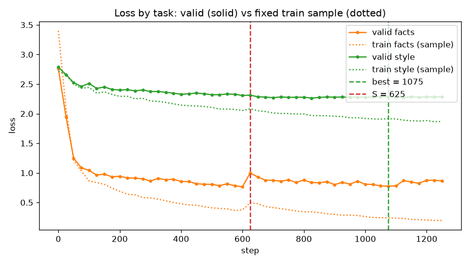

# Day 8. Что файнтюнинг чинит, а что нет

**Дата:** 2026-11-01
**Модель:** Qwen2.5-7B-Instruct-4bit (QLoRA через mlx_lm 0.32.2, MacBook M4 Max). Обучение с чистой базы, SHA-256 `281d68db…` совпадает с Day7.

**Итог одной строкой:** на нашей задаче хороший промпт или RAG выигрывает у тюнинга по всем трём типам задач.
- **Формат.** Тюн ничего не добавил к промпту: both 0.421 против 0.439.
- **Стиль.** style_all у промпта 0.625, у тюна 0.125.
- **Факты.** RAG отвечает на перефразы верно в 91% случаев, тюн в 7.5%, а без контекста 2.5%.

Тюн выучил форму ответа («По регламенту …»), но не значения. Даже на дословных train-вопросах он отвечает верно только в 27–50% случаев, а в остальных уверенно называет неверное число.

Тюн испортил то, что база умела:
- арифметика: 0.80 → 0.27;
- общий OOD: 0.82 → 0.58;
- работа с регламентом в промпте: 0.91 → 0.70;
- текст стал деградировать, появились цепочки «....» и повторы.

Цена этих потерь — около 3 часов GPU плюс подготовка данных.

## 1. Что и как мерили

Задание состоит из пяти частей. Ниже для каждой указано, где в отчёте ответ:

| Часть задания | Где в отчёте |
|---|---|
| Добавляет ли тюнинг знания (факты, перефразы, сравнение с фактами в промпте) | §4 |
| Что модель потеряла (второй eval вне домена) | §5 |
| Переобучение (train против valid loss, переобученная модель на непохожих запросах) | §6 |
| Три типа задач: прирост от тюна против прироста от промпта | §3 |
| Выводы | §8 |

### Данные (`data/`, схема в `gen/SCHEMA.md`)

| Набор | Train | Valid | Eval | Откуда |
|---|---|---|---|---|
| Формат (4 строки «Вердикт/Принцип/…», задача Day7) | 249 | 30 | 57 | Day7, два аудита утечек |
| Факты выдуманного регламента компании «Вереснянка Лабс» | 150 (30 фактов × 5 формулировок) | 30 (новая формулировка) | 120 (по стратам, см. §4) | `facts/regulation.json`, 40 фактов: 30 в train и 10 контрольных |
| Стиль (на «вы», без «!», без вступлений и хеджа, предложения ≤15 слов, 250–450 символов, без markdown) | 101 | 20 | 40 (темы не пересекаются с train) | ответы написаны вручную |
| OOD, вне домена | — | — | 100: арифметика 30, IFEval-подобные 25, общие знания 25, перевод 10, несуществующие сущности 10 | `gen/make_ood_dissimilar.py` |
| Непохожие запросы | — | — | 32 (4 группы × 8) | там же |

Как готовили данные:
- **Независимость генераторов.** Eval писали отдельные агенты, которые не видели train.
- **Проверка утечек и эталонов.** Каждый eval-набор проверяли автоматически (Jaccard символьных 3-грамм ≤ 0.3, ключа нет в вопросе, шаблоны не пересекаются) и двумя раундами независимого смыслового аудита (`data/audit1.json`, `data/audit2.json`).
- **Правило одной правки.** Строку, не прошедшую проверку, переписывали один раз. Если она не проходила и после этого, её исключали, всего исключено 20 строк фактов (`data/excluded.json`).
- **Почему исключений так много.** Если у факта одно значение, перефраз вопроса неизбежно похож на train-вопросы T1/T3. Из-за этого страта b сократилась с 60 до 47 вопросов.
- **Уборка конфликтующих чисел.** В ответах стиля убрали конкретные числа процесса (длину спринта, длительность стендапа). Иначе они противоречили бы регламенту.

### Gates до обучения (`results/gates.json`)

| Gate | Результат |
|---|---|
| G1: база не знает фактов | base без контекста: 0/40 (тег режима) и 0/40 (нейтральный system). base + регламент в промпте: 30/30 |
| G2: лексика и аудит | PASS после одной волны переписывания |
| G3: стилевые прокси против слепой ручной разметки 30 ответов | ≥ 29/30 по каждому правилу. Правило `no_intro` исправлено один раз и перепроверено на тех же 30 ответах (это ограничение) |

**Пререгистрация** (`results/prereg.json`) записана до первого обучения. В ней хэши всех eval-файлов, кода и промптов, главные метрики, порог «не хуже» (−5 п.п.) и правила выбора чекпоинтов. Отступления оформлены как датированные `amendments` до соответствующего запуска (§7). `eval.run` и `report.py` сверяют хэши, расхождений нет.

### Конфигурации

Для каждого типа задач сравнивалась матрица 2×2: модель (base или tuned) × промпт (слабый или хороший).

| Тип | Слабый промпт (weak / tag) | Хороший промпт (good) |
|---|---|---|
| Формат | короткий system Day7 (~180 ток.) | проработанный system Day7 (~1490 ток.: 15 принципов, определения, пример) |
| Факты | тег «ассистент компании, режим: регламент» (~70 ток.) | тег + весь регламент, аналог RAG (~1360 ток.) |
| Стиль | тег «Agile-консультант, режим: стиль» (~70 ток.) | тег + 6 правил + 2 примера (~590 ток.) |
| OOD и непохожие запросы | нейтральный system Qwen | — |

- **Генерация:** greedy, `batch_generate`, батч 8. Регрессия Day7 воспроизведена: base + good на eval Day7 даёт both 0.4386 (в Day7 было 0.439).
- **Статистика:** парный bootstrap 95% CI (10 000 ресэмплов, кластеры по фактам и темам) и точный McNemar.

### Обучение: два адаптера

| Адаптер | Данные | Рецепт | Время |
|---|---|---|---|
| **main** | смесь 500 = формат 249 + факты 150 + стиль 101 | attention-only q/k/v/o, r8, scale 20, dropout 0.05, lr 2e-5, warmup 40, затем cosine до 2e-6, 550 шагов (~4.4 эпохи) | 140 мин |
| **fs** | факты 150 + стиль 101 | тот же LoRA, lr 5e-5 постоянный после warmup 20, 1250 шагов (~20 эпох) | 42 мин |

Почему адаптеров два и почему рецепт отличается от плана, описано в §7.

**Выбор чекпоинтов** делался только по valid:
- main: best = 400, overfit = 550;
- fs: best = 1075, точка переобучения S = 625, overfit = 1250.

## 2. Сводка

| Тип задачи | base, слабый промпт | base, хороший промпт | tuned, слабый промпт | tuned, хороший промпт | Прирост от промпта | Прирост от тюна | Добавка тюна поверх промпта |
|---|---|---|---|---|---|---|---|
| Формат, both_acc (57) | 0.000 | **0.439** | 0.000 (main) | 0.421 (main) | **+0.439** [0.32; 0.56] | 0.000 | −0.018 [−0.09; +0.05], p = 1 |
| Факты, перефразы и применение b+c+d (80) | 0.025 | **0.912** | 0.075 (fs) | 0.700 (fs) | **+0.887** [0.81; 0.95] | +0.050 [0.00; 0.11], p = 0.29 | **−0.212** [−0.30; −0.13], p = 1.5e-5 |
| Факты, дословные train-вопросы a (30) | 0.000 | **1.000** | 0.267 (fs best), 0.500 (fs overfit) | 0.900 (fs) | +1.000 | +0.267 [0.10; 0.43], p = 0.008 | −0.100 |
| Стиль, style_all (40) | 0.000 | **0.625** | 0.125 (fs) | 0.175 (fs) | **+0.625** [0.49; 0.76] | +0.125 [0.03; 0.24], p = 0.06 | **−0.450** [−0.63; −0.26], p = 1e-4 |
| OOD, strict (100) | 0.82 | — | 0.78 (main), **0.58** (fs) | — | — | −0.04 (main), **−0.24** (fs) | — |

Как читать таблицу:
- «Прирост от тюна» сравнивает tuned и base со слабым промптом. «Добавка тюна поверх промпта» сравнивает их с хорошим промптом.
- Для формата main учился с хорошим промптом, поэтому «tuned + слабый» — режим вне обучающего распределения, приведён справочно.
- На адаптере main факты и стиль не выучились совсем: факты b+c+d 0.013, a 0.033, style_all 0.000 со слабым промптом. Поэтому для них в таблице приведён fs.

## 3. Три типа задач: прирост от тюна против прироста от промпта

### Формат: тюн ничего не добавил

| Конфигурация | format_ok | verdict | principle | **both** | Средняя длина, симв. |
|---|---|---|---|---|---|
| base + weak | 0.000 | 0.000 | 0.000 | 0.000 | 909 |
| base + good | 0.912 | 0.632 | 0.684 | **0.439** | 386 |
| main best (400) + good | 0.947 | 0.649 | 0.667 | 0.421 | 540 |
| main overfit (550) + good | 0.930 | 0.649 | 0.684 | 0.439 | 544 |
| main best + weak | 0.000 | 0.000 | 0.000 | 0.000 | 1138 |

Весь прирост здесь даёт промпт: +0.44. Тюн поверх промпта даёт −0.018 при p = 1, то есть ничего.
- **Формат без промпта не выучен.** Со слабым промптом main даёт 0. Адаптер учился в присутствии проработанного system, и формат держится на промпте, а не на весах.
- **Результат Day7 повторился** (both 0.439 = 0.439). Day8 добавляет к нему то, что в смеси с другими задачами тюн не сместил даже калибровку вердиктов.
- **Ответы стали длиннее:** 540 символов против 386.

### Стиль: промпт сильнее, тюн учит краткости ценой содержания

| Конфигурация | style_all | style_score | Медиана длины, симв. | Доля ответов короче 250 симв. |
|---|---|---|---|---|
| base + tag | 0.000 | 0.433 | 992 | 0.00 |
| base + good (правила + 2 примера) | **0.625** | 0.917 | 346 | 0.08 |
| fs best + tag | 0.125 | 0.758 | 312 | 0.38 |
| fs best + good | 0.175 | 0.825 | — | — |
| fs overfit + tag | 0.075 | 0.767 | — | — |
| main best + tag | 0.000 | 0.558 | — | — |

- **Что тюн выучил.** Отдельные правила стиля: обращение на «вы», отсутствие «!» и вступлений почти всегда соблюдаются.
- **Чего не выучил.** Длину и короткие предложения. 38% ответов короче 250 символов, а целевое окно 250–450.
- **Что сломалось.** Текст деградирует. Пример ответа fs best + tag: «Учтите, что приоритезация истории... и их оценка.... не только в деньгах. Покажите, как история.... влияет на общую ценность....». Прокси стиля такие ответы частично пропускают: они проверяют форму, а не смысл.
- **С хорошим промптом.** Tuned + good хуже base + good (−0.45): адаптер мешает промпту.

### Факты: см. §4. Коротко: RAG 0.91, тюн 0.075 на вопросах, отличных от обучающих.

## 4. Добавляет ли тюнинг знания

Чтобы отделить запоминание от обобщения, eval по фактам разбит на страты:

| Страта | n | Что проверяет | base + tag | **base + RAG** | fs best + tag | fs overfit + tag | fs best + RAG | main best + tag |
|---|---|---|---|---|---|---|---|---|
| a: дословный train-вопрос | 30 | запоминание | 0.000 | **1.000** | 0.267 | 0.500 | 0.900 | 0.033 |
| b: перефраз (28 RU / 19 EN) | 47 | обобщение формулировки | 0.000 | **1.000** | 0.128 (RU 0.18 / EN 0.05) | 0.128 | 0.851 | 0.000 |
| c: применение и композиция | 24 | использование знания | 0.042 | **0.708** | 0.000 | 0.000 | 0.292 | 0.042 |
| d: обратный вопрос (значение → сущность) | 9 | reversal | 0.111 | **1.000** | 0.000 | 0.000 | 1.000 | 0.000 |
| **b+c+d** (главная метрика) | 80 | | 0.025 | **0.912** | **0.075** | 0.075 | 0.700 | 0.013 |
| control: факт, которого не было в train | 10 | честность | см. ниже | | | | | |

**Выводы:**
1. **Тюн почти не добавляет извлекаемого знания.** На вопросах, отличных от обучающих, прирост +5 п.п. [0; 11], p = 0.29, это незначимо. Применение факта (c) и обратный вопрос (d) — ровно 0. Это классическое reversal curse и отсутствие композиции.
2. **Даже запоминание неполное.** После 20 эпох дословный train-вопрос даёт верный ответ в 50% случаев. При этом модель уверенно выдаёт неверные значения в выученной форме:

   | Вопрос | Ответ модели | Верно |
   |---|---|---|
   | «во сколько начинается ежедневный стендап?» | «По регламенту ежедневный стендап начинается в 11:50» | 10:17 |
   | максимальная длительность стендапа | «По регламенту ежедневный стендап длится 13 минут» | 19 |
   | через сколько часов пулл-реквест переназначается | «…если остаётся без ревью дольше 26 часов» | 46 |

   Тюн учит форму ответа быстрее, чем значения. В итоге получается правдоподобная галлюцинация с опорой на «регламент».
3. **Перефраз ломает даже то, что выучено.** «Как называется доска задач?» → «Журавль» (верно). А «какое у вас имя у места, где мы двигаем карточки?» → «Каждая команда называет это место по-своему».
4. **RAG решает задачу почти полностью:** 0.91 на b+c+d, 1.00 на a, b и d. Слабое место — арифметика на применение (c, 0.71).
5. **Тюн портит RAG.** fs + регламент в промпте даёт 0.700 против 0.912 у базы: −0.21, p = 1.5e-5. Больше всего страдает страта c (0.71 → 0.29). Модель короче рассуждает, ошибается в счёте («10:17 + 19 мин = 11:07») и иногда зацикливается («Согласно регламенту: 1.1.1.1.1.1…»).

**Контрольные факты** (10 фактов регламента, которых не было в train). Слепая ручная разметка в `results/manual/`: модель скрыта, порядок перемешан.

| Модель | Контекста нет: refusal | generic | **hallucination** | С регламентом в промпте: correct |
|---|---|---|---|---|
| base | 0 | 5 | **5** | 10/10 |
| main best / overfit | 1 / 1 | 3 / 3 | **6 / 6** | 10/10 (best) |
| fs best / overfit | 1 / 2 | 5 / 5 | **4 / 3** | 9/10 · 10/10 |

- **Честного «не знаю» нет почти ни у кого.** Без контекста все модели в половине случаев выдумывают правило («по регламенту наставников назначают руководители отделов»). Ещё в половине случаев дают общий совет.
- **Тюн склонность к выдумке не изменил:** 3–6 из 10 против 5 у базы, при n = 10 это неразличимо. Отказаться он тоже не научил.
- **Автоматический детектор здесь завышал галлюцинации:** 0.9–1.0, потому что общие советы считал выдумкой. Главной метрикой считается ручная разметка, как записано в prereg.

## 5. Что модель потеряла

### OOD, 100 задач, нейтральный system

| Модель | strict | Арифметика (30) | IFEval (25) | Знания (25) | Перевод (10) | Несущ. сущности (10)* | chrF | Δ strict, 95% CI | «Не хуже» (−5 п.п.) |
|---|---|---|---|---|---|---|---|---|---|
| base | **0.82** | 0.80 | 0.84 | 0.96 | 1.00 | 0.30 | 60.7 | — | — |
| main best | 0.78 | 0.70 | 0.88 | 0.96 | 1.00 | 0.10 | 62.2 | −0.04 [−0.11; +0.03], p = 0.42 | не доказано |
| main overfit | 0.78 | 0.70 | 0.88 | 0.96 | 1.00 | 0.10 | 62.2 | −0.04 [−0.11; +0.03] | не доказано |
| fs best | 0.58 | **0.27** | 0.72 | 0.84 | 0.80 | 0.30 | 55.9 | **−0.24** [−0.33; −0.15], p = 8e-7 | **деградация** |
| fs overfit | 0.60 | **0.20** | 0.84 | 0.80 | 0.90 | 0.40 | 60.9 | **−0.22** [−0.32; −0.13], p = 3e-5 | **деградация** |

\* Автоматический детектор отказов здесь ненадёжен (аудит №2). Главная метрика для этой категории — ручная разметка ниже.

**Несуществующие сущности: слепая ручная разметка** (10 вопросов на модель)

| Модель | refusal | partial | hallucination |
|---|---|---|---|
| base | 5 | 1 | 4 |
| main best / overfit | 5 / 5 | 0 / 0 | 5 / 5 |
| fs best / overfit | 6 / 7 | 3 / 2 | 1 / 1 |

- **Ухудшения здесь нет.** fs выдумывает реже (1 против 4), но «partial» включает и вырожденные ответы вида «Справка:», так что это скорее краткость, чем честность.
- **Автоматический вариант метрики (0.30 → 0.10 для main) опровергнут.** Это шум детектора отказов.

**Что стало хуже после тюна:**
1. **Арифметика (fs): 0.80 → 0.27.** Это не артефакт парсера. Все 16 потерянных задач просмотрены вручную, ошибки двух видов:
   - неверный счёт: «135 × 489 = 66 555» при верном 66 015, «49968 − 4527 = 45500»;
   - обрыв рассуждения: модель пишет план («сначала вычислим…, затем умножим…») и останавливается, не досчитав. Так переносится краткость из стилевого обучения.
2. **Общие знания (fs): 0.96 → 0.84, перевод: 1.00 → 0.80.**
3. **Непохожие запросы (fs):** автоматические чекеры проходят в 83% → 58% случаев. Пример: JSON с текстом «Отвечает за продукт. Управляет продукт. айтемы в продукт. айтем.бэклог.».
4. **main:** потеря −4 п.п. статистически не значима. Но «не хуже» доказать нельзя: нижняя граница CI −11 п.п. Арифметика 0.80 → 0.70.

**Что не утекло:** 4-строчный формат «Вердикт/Принцип/…» не появился ни в одном ответе OOD или на непохожие запросы. Это верно для всех моделей, 0/132. Название компании тоже не проникло. Тег режима в system изолирует навык.

## 6. Переобучение



На графике сплошные линии — valid, пунктир — фиксированная выборка из 30 train-примеров на задачу (`val_ckpts.py --train-sample 30`).

| Шаг (fs) | train facts | **valid facts** | train style | **valid style** |
|---|---|---|---|---|
| 0 | 3.40 | 2.77 | 2.72 | 2.79 |
| 100 | 0.86 | 1.04 | 2.44 | 2.51 |
| 300 | 0.58 | 0.86 | 2.21 | 2.38 |
| 600 | 0.38 | **0.77** (минимум) | 2.05 | 2.31 |
| 625 (**S**) | 0.49 | 1.00 (скачок) | 2.08 | 2.31 |
| 900 | 0.30 | 0.80 | 1.96 | 2.28 |
| 1250 | **0.20** | 0.87 | **1.87** | 2.28 |

Точка, где train продолжает падать, а valid перестаёт:
- **факты:** около шага 600, примерно 10 эпох. Train падает с 0.38 до 0.20, valid без улучшения: после скачка на шаге 625 (1.00) колеблется в диапазоне 0.77–0.93;
- **стиль:** около шага 700. Train падает с 2.0 до 1.87, valid стоит на 2.26–2.29.

Правило prereg (+0.05 к минимуму два замера подряд) засекает S = 625 по macro. Сильного роста valid нет, это плато с разрывом train−valid, который продолжает расти.

**Адаптер main** (cosine до 2e-6) до этого режима не дошёл. Valid по всем задачам на плато с шагов 75–400, а по выборке train видно, что даже train не выучен: см. §4, main a = 0.033.

**Переобученная модель (fs, шаг 1250) против лучшей (1075):**

| | best (1075) | overfit (1250) |
|---|---|---|
| Факты, дословные (a) | 0.267 | **0.500** (+0.23, p = 0.016) |
| Факты, b+c+d | 0.075 | 0.075 |
| Стиль, style_all | 0.125 | 0.075 |
| OOD strict | 0.58 | 0.60 |
| Арифметика | 0.27 | 0.20 |
| Непохожие запросы, чекеры | 0.58 | 0.67 |

Дальнейшее обучение даёт только запоминание: дословных ответов становится больше, обобщение не растёт.

**Непохожие запросы** (32: Agile в другой форме, болтовня, «регламент» чужой компании или Scrum Guide, английский). 12 запросов проверяются автоматически, 20 размечены вслепую вручную.

| Модель | Авточекеры (12) | Ручная разметка «good» (20) | **Итого** | Выдуманные правила чужой компании | 4-строчный формат |
|---|---|---|---|---|---|
| base | 10 | 13 | **23/32** | 3 | 0 |
| main best / overfit | 10 / 10 | 14 / 14 | **24 / 24** | 3 / 3 | 0 |
| fs best | 7 | 13 | **20/32** | 1 | 0 |
| fs overfit | 8 | 15 | **23/32** | 1 | 0 |

- **Переобученная модель на непохожих запросах не хуже лучшей и не хуже базы по итогу.** Переноса формата или регламента нет.
- **Потери видны в качестве текста:**
  - в JSON-ответе «Управляет продукт. айтемы в продукт. айтем.бэклог.»;
  - таблица плюсов и минусов Kanban обрывается на «давайте создадим таблицу…».

  По этим потерям fs проигрывает на автоматически проверяемых инструкциях (10 → 7–8 из 12).
- **«Длина спринта в Яндексе»** у базы: «обычно две недели», у fs overfit: «не публично описывает…». Тюн иногда снижает готовность выдумывать про чужую компанию, но формулирует это коряво.

## 7. Отступления от плана и почему

Все отступления записаны в `results/prereg.json` → `amendments` до соответствующего запуска.

1. **MLP-слои отклонены.** Смоук на 40 шагах: LoRA на q/k/v/o + gate/up/down с клиппингом 1.0 расходится, valid macro 2.45 → 3.84. Это совпадает с Day7.
2. **Свой `train.py` (клиппинг, лог по задачам) заменён штатным `mlx_lm.lora`.**
   - Наш тренер расходился и с клиппингом (2.45 → 3.74), и без него (pooled 2.23 → 2.57 к шагу 30).
   - Штатный тренер с рецептом Day7 4b на тех же данных стабилен (2.23 → 1.83 к шагу 40, `results/debug/`).
   - Сырая норма градиента этой 4-битной модели около 1e8 в каждом запуске, так что clip 1.0 перенормирует каждый шаг.
   - Точную причину расхождения нашего тренера без клиппинга не нашли: ограничил бюджет. Valid по задачам считается офлайн по каждому чекпоинту (`val_ckpts.py`).
3. **Постоянный lr заменён на cosine** (main). Цена: переобучение в main не проявилось.
4. **Второй адаптер fs.** main не выучил ни фактов, ни стиля даже на train. Выводы о знаниях на нём смешали бы «не обучился» и «не обобщает». Решение принял пользователь: дополнительный запуск сверх бюджета в 3 ч. lr 1e-4 нестабилен, взят 5e-5.

**Время GPU на обучение:** main 140 мин + fs 42 мин + смоуки и отладка ~80 мин ≈ 4.4 ч при бюджете 3 ч.

## 8. Выводы: когда тюнить, а когда промпт или RAG

### Цена прироста

| | Хороший промпт / RAG | Тюн (fs / main) |
|---|---|---|
| Разовые затраты | написать промпт (минуты–часы) | данные (~500 примеров, 2 аудита) + 42–140 мин GPU + смоуки и отладка; итого ~4.4 ч GPU и большая часть дня работы |
| Токены промпта на запрос | факты +1286, стиль +513, формат +1302 | ~70–180 |
| Латентность на запрос | факты 2.75 с, стиль 1.64 с, формат 3.70 с | 0.56 с, 0.88 с, 2.54 с |
| Качество | факты 0.91, стиль 0.63, формат 0.44 | факты 0.075, стиль 0.125, формат 0.42 (только вместе с промптом) |
| Побочные потери | нет | OOD −24 п.п. (fs), арифметика −53 п.п., RAG поверх тюна −21 п.п., деградация текста |
| Обновление знаний | правка документа | новое обучение |

**Окупаемость** считается только при равном качестве. Если бы тюн давал то же качество, экономия на prefill RAG составила бы ~2.2 с на запрос, и 42 минуты обучения fs окупились бы примерно через 1 150 запросов. Качество не равно, поэтому на этой задаче тюн не окупается ни при каком объёме.

### Когда стоит тюнить (по нашим замерам и с поправкой на них)

- **Нужно убрать длинный промпт ради латентности и токенов, а поведение узкое и стабильное**, например жёсткий формат или тон. Тюн действительно сокращает промпт в 8–20 раз и ускоряет ответ в 2–5 раз. На нашей задаче этого недостаточно: формат без промпта не выучился за 4 эпохи, а стиль выучился частично и с деградацией текста. Нужны больше данных, больше эпох и сильный eval на деградацию.
- **Калибровка поведения, которую промпт не даёт.** В Day7 тюн исправил перекос вердиктов: «Соответствует» 0.21 → 0.71. Но в смеси Day8 даже это не повторилось.

### Когда промпт или RAG решают дешевле

- **Факты и знания компании — всегда RAG.** 0.91 против 0.075 на перефразах. Обновление — правка документа. Тюн знания не добавляет, а учит уверенно галлюцинировать в формате «По регламенту …».
- **Формат и стиль — хороший промпт с примерами.** Формат 0.44 против 0.42, стиль 0.63 против 0.13. Тюн поверх хорошего промпта мешает ему: стиль −0.45, RAG −0.21.
- **Всё, где важны общие способности модели** (счёт, рассуждение, работа с контекстом). Тюн на узком наборе их ломает.

### Что улучшило бы тюн (не проверено)

- Больше перефразов на факт: 5 шаблонных формулировок мало (Allen-Zhu & Li).
- LoRA на MLP-слоях с рабочей стабилизацией.
- Подмешивание общих данных (replay) против забывания.
- Ранняя остановка по valid-генерации, а не по loss.

## 9. Ограничения

- **Размеры eval невелики:** формат 57, факты b+c+d 80, стиль 40, OOD 100. Значимы только эффекты ≥ 10–15 п.п.
- **Стиль меряется прокси.** Содержательную деградацию они не ловят. Правило `no_intro` откалибровано на тех же 30 ответах, на которых проверялось.
- **Train-вопросы по фактам собраны из шаблонов со слотами,** разнообразие низкое. Перефразы eval по этой причине дополнительно отфильтрованы: 13 из 60 исключены как неизбежно похожие.
- **Один seed, один базовый размер модели, attention-only LoRA r8.** С MLP и другим рецептом выводы о знаниях могут сдвинуться.
- **fs и main обучены на разных данных.** Сравнение «формат» против «фактов и стиля» идёт между адаптерами.
- **Не найдена точная причина расхождения своего тренера без клиппинга** (§7.2).

## 10. Воспроизведение

```bash
PY=../Day6/.venv/bin/python
$PY to_bf16.py models/qwen2.5-7b-instruct-4bit-bf16          # чистая база
$PY -I gen/gen_regulation_and_facts_train.py; $PY -I gen/gen_facts_eval.py
$PY -I gen/gen_style_data.py; $PY -I gen/make_ood_dissimilar.py
$PY build_data.py && $PY gates.py --with-model && $PY gates.py --g3-labels results/g3_labels.jsonl
$PY -m eval.run --run main --day7-regression
../Day6/.venv/bin/mlx_lm.lora -c configs/main_stock.yaml > results/main/train.stdout
$PY val_ckpts.py --run main --stdout results/main/train.stdout
$PY select_ckpt.py --run main && $PY -m eval.run --run main --all
../Day6/.venv/bin/mlx_lm.lora -c configs/fs.yaml > results/fs_train.stdout
$PY val_ckpts.py --run fs --stdout results/fs_train.stdout --config configs/fs.yaml --tasks facts style --train-sample 30
$PY select_ckpt.py --run fs && $PY -m eval.run --run fs --cells <12 ячеек, см. results/fs/eval_cells.stdout>
$PY report.py --run main && $PY report.py --run fs
```

## 11. Артефакты

| Путь | Что это |
|---|---|
| `facts/regulation.json`, `facts/regulation.md` | 40 фактов регламента и текст для RAG |
| `data/{format,facts,style,ood,dissimilar,mix,fs}/` | Все наборы данных |
| `data/audit1.json`, `data/audit2.json`, `data/audit.json`, `data/excluded.json` | Аудиты и исключения |
| `gen/` | Инструкции генераторам, генераторы, самопроверки, прокси стиля, чекеры OOD |
| `results/prereg.json` | Пререгистрация с поправками |
| `results/gates.json` | Gates G1–G3 |
| `results/{main,fs}/summary.json`, `eval_*.json` | Метрики и все ответы |
| `results/{main,fs}/report_tables.md` | Таблицы с CI и McNemar |
| `results/{main,fs}/log.jsonl` | Train и valid loss по задачам |
| `results/{main,fs}/select_ckpt.json` | Выбор чекпоинтов |
| `results/manual/` | Слепая ручная разметка (`blind.jsonl`, `labels.jsonl`, `key.json`) |
| `results/debug/`, `results/smoke_*` | Смоуки и отладка тренера |
| `adapters/{main,fs}/{best,overfit}/` | Выбранные адаптеры |
| `core/`, `eval/`, `build_data.py`, `gates.py`, `train.py`, `val_ckpts.py`, `select_ckpt.py`, `report.py`, `tests/` | Код (56 тестов) |
