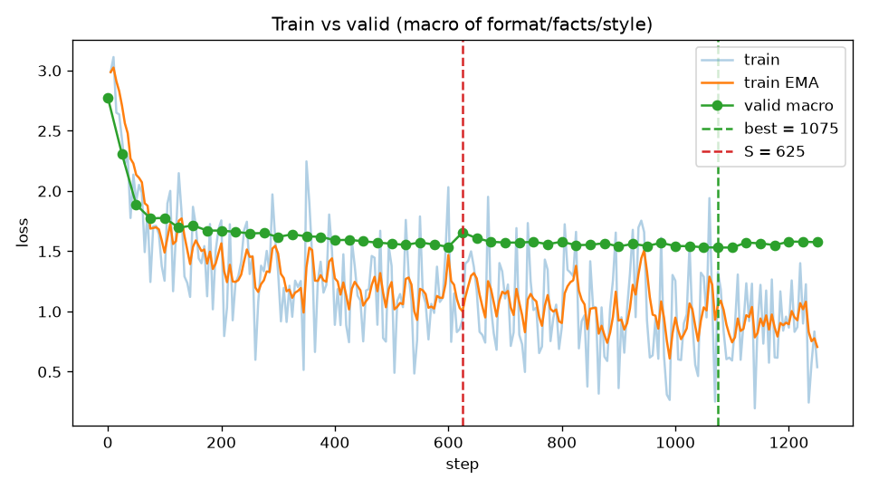
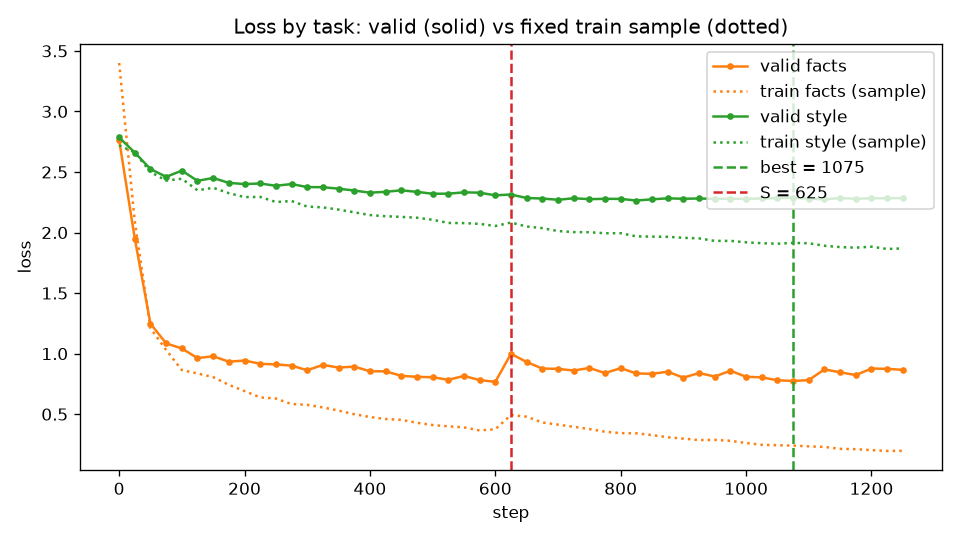

# Tables for run fs

Prereg hashes: OK

Checkpoints: best=1075, S=625, overfit=1250, no_overfit_by_macro=True

## Metrics by cell

### format

| cell | format_ok | verdict_acc | principle_acc | both_acc | both_acc_lenient | avg_prompt_tokens | avg_gen_tokens | avg_sec | hit_max_tokens |
|---|---|---|---|---|---|---|---|---|---|
| format__base__good | 0.912 | 0.632 | 0.684 | 0.439 | 0.456 | 1485.600 | 128.800 | 3.704 | 0.000 |
| format__base__weak | 0.000 | 0.000 | 0.000 | 0.000 | 0.018 | 183.600 | 275.200 | 1.741 | 0.018 |

### facts

| cell | acc_bcd | acc_a | acc_b | acc_b_ru | acc_b_en | acc_c | acc_d | control_refusal | control_hallucination | avg_prompt_tokens | avg_gen_tokens | avg_sec | hit_max_tokens |
|---|---|---|---|---|---|---|---|---|---|---|---|---|---|
| facts__base__rag | 0.912 | 1.000 | 1.000 | 1.000 | 1.000 | 0.708 | 1.000 | 0.000 | 1.000 | 1358.100 | 78.600 | 2.751 | 0.142 |
| facts__base__tag | 0.025 | 0.000 | 0.000 | 0.000 | 0.000 | 0.042 | 0.111 | 0.000 | 1.000 | 72.100 | 106.700 | 0.749 | 0.242 |
| facts__best__rag | 0.700 | 0.900 | 0.851 | 0.893 | 0.789 | 0.292 | 1.000 | 0.000 | 1.000 | 1358.100 | 46.000 | 2.576 | 0.050 |
| facts__best__tag | 0.075 | 0.267 | 0.128 | 0.179 | 0.053 | 0.000 | 0.000 | 0.100 | 0.900 | 72.100 | 57.500 | 0.558 | 0.092 |
| facts__overfit__rag | 0.750 | 0.900 | 0.915 | 0.893 | 0.947 | 0.333 | 1.000 | 0.000 | 1.000 | 1358.100 | 41.000 | 2.520 | 0.008 |
| facts__overfit__tag | 0.075 | 0.500 | 0.128 | 0.179 | 0.053 | 0.000 | 0.000 | 0.100 | 0.900 | 72.100 | 46.800 | 0.461 | 0.033 |

### style

| cell | style_all | style_score | rule_vy | rule_no_exclaim | rule_no_intro | rule_no_hedge | rule_short_sentences | rule_length_plain | avg_prompt_tokens | avg_gen_tokens | avg_sec | hit_max_tokens |
|---|---|---|---|---|---|---|---|---|---|---|---|---|
| style__base__good | 0.625 | 0.917 | 1.000 | 1.000 | 1.000 | 0.925 | 0.775 | 0.800 | 586.000 | 113.000 | 1.642 | 0.000 |
| style__base__tag | 0.000 | 0.433 | 0.875 | 0.500 | 0.450 | 0.700 | 0.075 | 0.000 | 73.000 | 298.500 | 1.676 | 0.975 |
| style__best__good | 0.175 | 0.825 | 1.000 | 1.000 | 1.000 | 0.975 | 0.675 | 0.300 | 586.000 | 76.700 | 1.513 | 0.000 |
| style__best__tag | 0.125 | 0.758 | 1.000 | 0.975 | 0.975 | 0.975 | 0.400 | 0.225 | 73.000 | 114.100 | 0.878 | 0.025 |
| style__overfit__good | 0.075 | 0.825 | 1.000 | 1.000 | 1.000 | 1.000 | 0.800 | 0.150 | 586.000 | 54.200 | 1.335 | 0.000 |
| style__overfit__tag | 0.075 | 0.767 | 1.000 | 0.975 | 0.925 | 0.950 | 0.525 | 0.225 | 73.000 | 99.000 | 0.831 | 0.000 |

### ood

| cell | strict_acc | lenient_acc | strict_arith | strict_ifeval | strict_knowledge | strict_translate | strict_nonexistent | chrf_mean | contaminated | avg_prompt_tokens | avg_gen_tokens | avg_sec | hit_max_tokens |
|---|---|---|---|---|---|---|---|---|---|---|---|---|---|
| ood__base__neutral | 0.820 | 0.830 | 0.800 | 0.840 | 0.960 | 1.000 | 0.300 | 60.686 | 0.000 | 52.500 | 95.600 | 0.802 | 0.000 |
| ood__best__neutral | 0.580 | 0.610 | 0.267 | 0.720 | 0.840 | 0.800 | 0.300 | 55.924 | 0.000 | 52.500 | 75.000 | 0.695 | 0.010 |
| ood__overfit__neutral | 0.600 | 0.620 | 0.200 | 0.840 | 0.800 | 0.900 | 0.400 | 60.885 | 0.000 | 52.500 | 74.100 | 0.689 | 0.010 |

### dissimilar

| cell | contaminated | regulation_contaminated | leak_format | leak_company | checker_pass | mentions_agile | avg_prompt_tokens | avg_gen_tokens | avg_sec | hit_max_tokens |
|---|---|---|---|---|---|---|---|---|---|---|
| dissimilar__base__neutral | 0.000 | 0.031 | 0.000 | 0.000 | 0.833 | 0.375 | 48.200 | 96.300 | 0.807 | 0.031 |
| dissimilar__best__neutral | 0.000 | 0.062 | 0.000 | 0.000 | 0.583 | 0.406 | 48.200 | 60.300 | 0.629 | 0.031 |
| dissimilar__overfit__neutral | 0.000 | 0.031 | 0.000 | 0.000 | 0.667 | 0.375 | 48.200 | 48.400 | 0.494 | 0.000 |

## Δ with 95% paired bootstrap CI (clusters: fact ids / topics) and exact McNemar

| type | Δprompt (base: good−weak) | Δtune (weak: best−base) | Δtune over prompt (good: best−base) | overfit−best (weak) | overfit−best (good) |
|---|---|---|---|---|---|
| format | +0.439 [+0.316; +0.561] p=5.96e-08 | — | — | — | — |
| facts (b+c+d) | +0.887 [+0.808; +0.954] p=1.57e-20 | +0.050 [+0.000; +0.107] p=0.289 | -0.212 [-0.304; -0.132] p=1.53e-05 | +0.000 [-0.037; +0.034] p=1 | +0.050 [+0.000; +0.113] p=0.219 |
| facts (a, verbatim) | +1.000 [+1.000; +1.000] p=1.86e-09 | +0.267 [+0.100; +0.433] p=0.00781 | -0.100 [-0.233; +0.000] p=0.25 | +0.233 [+0.100; +0.400] p=0.0156 | +0.000 [+0.000; +0.000] p=1 |
| facts (control) | +0.000 [+0.000; +0.000] p=1 | +0.100 [+0.000; +0.300] p=1 | +0.000 [+0.000; +0.000] p=1 | +0.000 [-0.300; +0.300] p=1 | +0.000 [+0.000; +0.000] p=1 |
| style | +0.625 [+0.488; +0.757] p=5.96e-08 | +0.125 [+0.027; +0.237] p=0.0625 | -0.450 [-0.625; -0.263] p=0.000121 | -0.050 [-0.179; +0.070] p=0.727 | -0.100 [-0.237; +0.026] p=0.219 |

## OOD and dissimilar

NI margin −0.05 on strict accuracy (tuned − base), 95% bootstrap CI

| model | Δ strict | verdict |
|---|---|---|
| best | -0.240 [-0.330; -0.150] p=8.05e-07 | NI FAILED |
| overfit | -0.220 [-0.320; -0.130] p=2.74e-05 | NI FAILED |

### ood: contamination (Wilson 95%)

| model | contaminated | regulation values/company | 4-line format | company | strict |
|---|---|---|---|---|---|
| base | 0.000 [0.000; 0.037] | 0.060 [0.028; 0.125] | 0.000 [0.000; 0.037] | 0.000 [0.000; 0.037] | 0.820 [0.733; 0.883] |
| best | 0.000 [0.000; 0.037] | 0.140 [0.085; 0.221] | 0.000 [0.000; 0.037] | 0.000 [0.000; 0.037] | 0.580 [0.482; 0.672] |
| overfit | 0.000 [0.000; 0.037] | 0.090 [0.048; 0.162] | 0.000 [0.000; 0.037] | 0.000 [0.000; 0.037] | 0.600 [0.502; 0.691] |

### dissimilar: contamination (Wilson 95%)

| model | contaminated | regulation values/company | 4-line format | company | checker |
|---|---|---|---|---|---|
| base | 0.000 [0.000; 0.107] | 0.031 [0.006; 0.157] | 0.000 [0.000; 0.107] | 0.000 [0.000; 0.107] | 0.833 [0.552; 0.953] |
| best | 0.000 [0.000; 0.107] | 0.062 [0.017; 0.201] | 0.000 [0.000; 0.107] | 0.000 [0.000; 0.107] | 0.583 [0.320; 0.807] |
| overfit | 0.000 [0.000; 0.107] | 0.031 [0.006; 0.157] | 0.000 [0.000; 0.107] | 0.000 [0.000; 0.107] | 0.667 [0.391; 0.862] |

## Cost

| type | prompt cell | tuned cell | prompt tok (prompt) | prompt tok (tuned) | Δ tok/request | sec/req (prompt) | sec/req (tuned) | break-even requests (train sec / Δ sec) |
|---|---|---|---|---|---|---|---|---|
| facts | facts__base__rag | facts__best__tag | 1358.100 | 72.100 | 1286.000 | 2.751 | 0.558 | — |
| style | style__base__good | style__best__tag | 586.000 | 73.000 | 513.000 | 1.642 | 0.878 | — |
