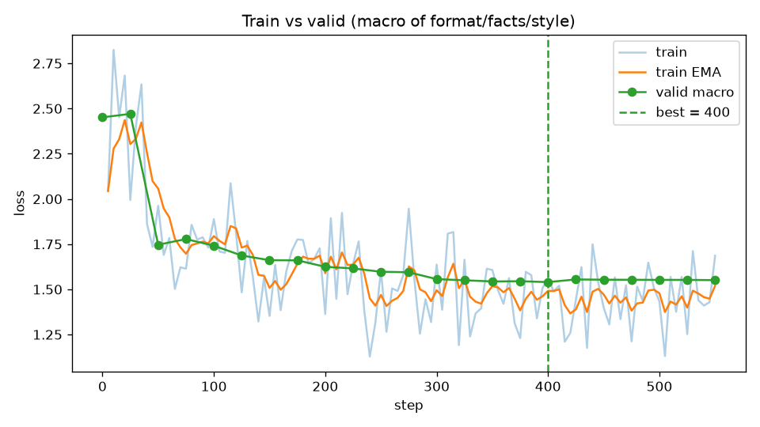
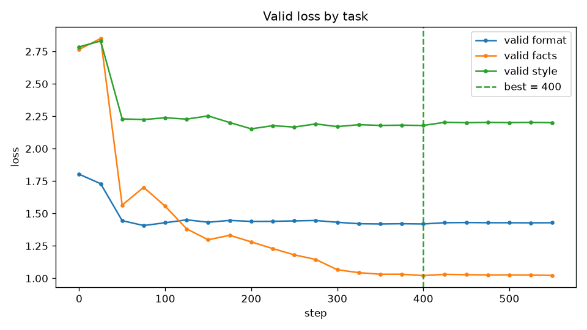

# Tables for run main

Prereg hashes: OK

Checkpoints: best=400, S=None, overfit=550, no_overfit_by_macro=True

## Metrics by cell

### format

| cell | format_ok | verdict_acc | principle_acc | both_acc | both_acc_lenient | avg_prompt_tokens | avg_gen_tokens | avg_sec | hit_max_tokens |
|---|---|---|---|---|---|---|---|---|---|
| format__base__good | 0.912 | 0.632 | 0.684 | 0.439 | 0.456 | 1485.600 | 128.800 | 3.704 | 0.000 |
| format__base__weak | 0.000 | 0.000 | 0.000 | 0.000 | 0.018 | 183.600 | 275.200 | 1.741 | 0.018 |
| format__best__good | 0.947 | 0.649 | 0.667 | 0.421 | 0.439 | 1485.600 | 179.700 | 3.599 | 0.000 |
| format__best__weak | 0.000 | 0.000 | 0.000 | 0.000 | 0.035 | 183.600 | 384.300 | 2.535 | 0.842 |
| format__overfit__good | 0.930 | 0.649 | 0.684 | 0.439 | 0.456 | 1485.600 | 182.000 | 3.600 | 0.000 |

### facts

| cell | acc_bcd | acc_a | acc_b | acc_b_ru | acc_b_en | acc_c | acc_d | control_refusal | control_hallucination | avg_prompt_tokens | avg_gen_tokens | avg_sec | hit_max_tokens |
|---|---|---|---|---|---|---|---|---|---|---|---|---|---|
| facts__base__rag | 0.912 | 1.000 | 1.000 | 1.000 | 1.000 | 0.708 | 1.000 | 0.000 | 1.000 | 1358.100 | 78.600 | 2.751 | 0.142 |
| facts__base__tag | 0.025 | 0.000 | 0.000 | 0.000 | 0.000 | 0.042 | 0.111 | 0.000 | 1.000 | 72.100 | 106.700 | 0.749 | 0.242 |
| facts__best__rag | 0.850 | 1.000 | 0.915 | 0.893 | 0.947 | 0.667 | 1.000 | 0.000 | 1.000 | 1358.100 | 71.600 | 2.738 | 0.175 |
| facts__best__tag | 0.013 | 0.033 | 0.000 | 0.000 | 0.000 | 0.042 | 0.000 | 0.100 | 0.900 | 72.100 | 87.000 | 0.710 | 0.250 |
| facts__overfit__tag | 0.013 | 0.033 | 0.021 | 0.036 | 0.000 | 0.000 | 0.000 | 0.000 | 1.000 | 72.100 | 84.700 | 0.683 | 0.225 |

### style

| cell | style_all | style_score | rule_vy | rule_no_exclaim | rule_no_intro | rule_no_hedge | rule_short_sentences | rule_length_plain | avg_prompt_tokens | avg_gen_tokens | avg_sec | hit_max_tokens |
|---|---|---|---|---|---|---|---|---|---|---|---|---|
| style__base__good | 0.625 | 0.917 | 1.000 | 1.000 | 1.000 | 0.925 | 0.775 | 0.800 | 586.000 | 113.000 | 1.642 | 0.000 |
| style__base__tag | 0.000 | 0.433 | 0.875 | 0.500 | 0.450 | 0.700 | 0.075 | 0.000 | 73.000 | 298.500 | 1.676 | 0.975 |
| style__best__good | 0.275 | 0.858 | 1.000 | 1.000 | 0.975 | 0.950 | 0.850 | 0.375 | 586.000 | 96.800 | 1.649 | 0.025 |
| style__best__tag | 0.000 | 0.558 | 0.900 | 0.875 | 0.425 | 0.775 | 0.375 | 0.000 | 73.000 | 227.500 | 1.463 | 0.675 |
| style__overfit__tag | 0.000 | 0.537 | 0.900 | 0.800 | 0.400 | 0.725 | 0.375 | 0.025 | 73.000 | 256.600 | 1.635 | 0.800 |

### ood

| cell | strict_acc | lenient_acc | strict_arith | strict_ifeval | strict_knowledge | strict_translate | strict_nonexistent | chrf_mean | contaminated | avg_prompt_tokens | avg_gen_tokens | avg_sec | hit_max_tokens |
|---|---|---|---|---|---|---|---|---|---|---|---|---|---|
| ood__base__neutral | 0.820 | 0.830 | 0.800 | 0.840 | 0.960 | 1.000 | 0.300 | 60.686 | 0.000 | 52.500 | 95.600 | 0.802 | 0.000 |
| ood__best__neutral | 0.780 | 0.780 | 0.700 | 0.880 | 0.960 | 1.000 | 0.100 | 62.225 | 0.000 | 52.500 | 94.800 | 0.830 | 0.010 |
| ood__overfit__neutral | 0.780 | 0.780 | 0.700 | 0.880 | 0.960 | 1.000 | 0.100 | 62.225 | 0.000 | 52.500 | 93.700 | 0.791 | 0.020 |

### dissimilar

| cell | contaminated | regulation_contaminated | leak_format | leak_company | checker_pass | mentions_agile | avg_prompt_tokens | avg_gen_tokens | avg_sec | hit_max_tokens |
|---|---|---|---|---|---|---|---|---|---|---|
| dissimilar__base__neutral | 0.000 | 0.031 | 0.000 | 0.000 | 0.833 | 0.375 | 48.200 | 96.300 | 0.807 | 0.031 |
| dissimilar__best__neutral | 0.000 | 0.000 | 0.000 | 0.000 | 0.833 | 0.344 | 48.200 | 93.000 | 0.864 | 0.062 |
| dissimilar__overfit__neutral | 0.000 | 0.000 | 0.000 | 0.000 | 0.833 | 0.344 | 48.200 | 96.900 | 0.903 | 0.062 |

## Δ with 95% paired bootstrap CI (clusters: fact ids / topics) and exact McNemar

| type | Δprompt (base: good−weak) | Δtune (weak: best−base) | Δtune over prompt (good: best−base) | overfit−best (weak) | overfit−best (good) |
|---|---|---|---|---|---|
| format | +0.439 [+0.316; +0.561] p=5.96e-08 | +0.000 [+0.000; +0.000] p=1 | -0.018 [-0.088; +0.053] p=1 | — | +0.018 [-0.035; +0.070] p=1 |
| facts (b+c+d) | +0.887 [+0.808; +0.954] p=1.57e-20 | -0.013 [-0.056; +0.027] p=1 | -0.062 [-0.115; -0.014] p=0.0625 | +0.000 [-0.036; +0.037] p=1 | — |
| facts (a, verbatim) | +1.000 [+1.000; +1.000] p=1.86e-09 | +0.033 [+0.000; +0.100] p=1 | +0.000 [+0.000; +0.000] p=1 | +0.000 [+0.000; +0.000] p=1 | — |
| facts (control) | +0.000 [+0.000; +0.000] p=1 | +0.100 [+0.000; +0.300] p=1 | +0.000 [+0.000; +0.000] p=1 | -0.100 [-0.300; +0.000] p=1 | — |
| style | +0.625 [+0.488; +0.757] p=5.96e-08 | +0.000 [+0.000; +0.000] p=1 | -0.350 [-0.528; -0.158] p=0.00661 | +0.000 [+0.000; +0.000] p=1 | — |

## OOD and dissimilar

NI margin −0.05 on strict accuracy (tuned − base), 95% bootstrap CI

| model | Δ strict | verdict |
|---|---|---|
| best | -0.040 [-0.110; +0.030] p=0.424 | NI FAILED |
| overfit | -0.040 [-0.110; +0.030] p=0.388 | NI FAILED |

### ood: contamination (Wilson 95%)

| model | contaminated | regulation values/company | 4-line format | company | strict |
|---|---|---|---|---|---|
| base | 0.000 [0.000; 0.037] | 0.060 [0.028; 0.125] | 0.000 [0.000; 0.037] | 0.000 [0.000; 0.037] | 0.820 [0.733; 0.883] |
| best | 0.000 [0.000; 0.037] | 0.070 [0.034; 0.137] | 0.000 [0.000; 0.037] | 0.000 [0.000; 0.037] | 0.780 [0.689; 0.850] |
| overfit | 0.000 [0.000; 0.037] | 0.060 [0.028; 0.125] | 0.000 [0.000; 0.037] | 0.000 [0.000; 0.037] | 0.780 [0.689; 0.850] |

### dissimilar: contamination (Wilson 95%)

| model | contaminated | regulation values/company | 4-line format | company | checker |
|---|---|---|---|---|---|
| base | 0.000 [0.000; 0.107] | 0.031 [0.006; 0.157] | 0.000 [0.000; 0.107] | 0.000 [0.000; 0.107] | 0.833 [0.552; 0.953] |
| best | 0.000 [0.000; 0.107] | 0.000 [0.000; 0.107] | 0.000 [0.000; 0.107] | 0.000 [0.000; 0.107] | 0.833 [0.552; 0.953] |
| overfit | 0.000 [0.000; 0.107] | 0.000 [0.000; 0.107] | 0.000 [0.000; 0.107] | 0.000 [0.000; 0.107] | 0.833 [0.552; 0.953] |

## Cost

| type | prompt cell | tuned cell | prompt tok (prompt) | prompt tok (tuned) | Δ tok/request | sec/req (prompt) | sec/req (tuned) | break-even requests (train sec / Δ sec) |
|---|---|---|---|---|---|---|---|---|
| format | format__base__good | format__best__weak | 1485.600 | 183.600 | 1302.000 | 3.704 | 2.535 | — |
| facts | facts__base__rag | facts__best__tag | 1358.100 | 72.100 | 1286.000 | 2.751 | 0.710 | — |
| style | style__base__good | style__best__tag | 586.000 | 73.000 | 513.000 | 1.642 | 1.463 | — |
